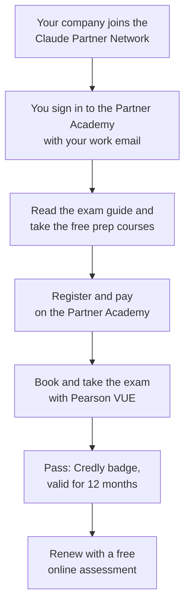

Anthropic offers four Claude certifications: Associate, Developer, Architect Foundations and Architect Professional. You earn them by passing a proctored exam on the Anthropic Partner Academy. The catch for most developers: **today, only people who work at a Claude Partner Network organization can register.** If that's not you yet, you can still learn everything the exams cover with Anthropic's free courses.

This post explains which certifications exist, who can take them, what the best-documented exam (Claude Certified Architect – Foundations) looks like, and what to do if you can't register yet.

## What is a Claude certification?

A Claude certification is a credential that proves you can build and run real solutions with Claude. Anthropic's [Services Track announcement](https://www.anthropic.com/news/services-track-partner-hub) describes it as "a credential, held by an individual, that signals they've been trained to build and deploy Claude in production."

Three points matter:

- **It belongs to you, not your employer.** The [certification policies](https://anthropic-partners.skilljar.com/page/policies-certifications) say it stays with you if you change jobs.
- **It is tied to the partner program.** Anthropic launched the first certification alongside the [Claude Partner Network](https://www.anthropic.com/news/claude-partner-network), its program for companies that help other businesses adopt Claude. A partner firm's tier depends partly on how many certified people it has.
- **It is earned through an exam.** Anthropic says certifications "are earned through Anthropic Partner Academy exams." The Partner Academy is Anthropic's training site for partners. The exams themselves are run by Pearson VUE, a testing company, and badges are issued by Credly.

## Which Claude certifications are there?

The [certifications page](https://anthropic-partners.skilljar.com/page/partner-certifications) on the Partner Academy lists four, grouped by role:

| Certification | Who it's for | Price (USD) |
| --- | --- | --- |
| Claude Certified Associate – Foundations | Consultants, sellers and delivery leads who guide customers to the right Claude use cases | $99 |
| Claude Certified Developer – Foundations | Engineers who build with the Claude API, Claude Code and MCP, from first integration to production agents | $125 |
| Claude Certified Architect – Foundations | Solution architects who design and build production applications with Claude | $125 |
| Claude Certified Architect – Professional | Architects who design and govern Claude solutions end to end at enterprise scale | $175 |

Prices are before any partner discount. Some details from the [certification FAQ](https://anthropic-partners.skilljar.com/page/faq-certifications):

- **Architect Foundations and Professional are separate exams.** Foundations is "the natural place to start," but there is no formal prerequisite, and Foundations doesn't upgrade to Professional automatically.
- **Associate doesn't count toward a firm's partner tier.** The Developer and both Architect exams do.
- **All exams share one format:** multiple-choice and scenario-based multiple-response questions, 120 minutes, and a passing score of 720 on a 100–1,000 scale.

If you build with Claude as a developer, Developer – Foundations and Architect – Foundations are the two to look at. The next post in this series, [Claude Developer vs Architect exam: which should you take?](/blog/which-claude-certification), compares them.

## Who can take a Claude certification?

Short answer: people at Claude Partner Network organizations who are at least 18.

The FAQ is direct about it:

- "Certification is available to people at Claude Partner Network organizations. Registration requires a partner email address on a recognized company domain — personal email addresses will not work."
- "Certification is currently available only to organizations in the Claude Partner Network." That rules out customers and non-partners for now.
- You must be at least 18. Your age is checked against your government ID when you check in.

**What this means for you as an individual developer:** you can't sign up with a personal email today. You have three options:

1. **Your employer is already a partner.** Sign in to the Partner Academy with your work email. If it says you aren't signed in with a partner email, the FAQ says to contact Anthropic's partner support, and that adding your company's email domain takes 7 to 10 days.
2. **Your employer could become a partner.** Anthropic says "any organization that is bringing Claude to market is eligible to join the Claude Partner Network" and that membership is free. New applicants start at the Registered level, with "a minimum commitment to 10 certified practitioners". So this is a company decision, not a personal one. Point your manager to [claude.com/partners](https://claude.com/partners).
3. **Neither applies.** Learn the material with free courses now (see below) and check the FAQ again later. The rules say "currently", so they may change.

## How do you get certified?

If you are eligible, registration follows the same steps for every exam:

<Steps>

<Step title="Open your certification's page">

Go to the [certifications page](https://anthropic-partners.skilljar.com/page/partner-certifications) and pick the exam. Each page links the exam guide, the prep courses and the registration button.

</Step>

<Step title="Read the exam guide and the policies">

The exam guide is a PDF on the certification's page. It lists every topic the exam can test and is "the authoritative source for exam scope." Read the [certification policies](https://anthropic-partners.skilljar.com/page/policies-certifications) too: you agree to them when you register.

</Step>

<Step title="Register and pay">

You pay by credit card on the Partner Academy. Any discount for your company's partner tier is applied automatically at checkout. Your registration is valid for 5 years, so you don't need to book right away.

</Step>

<Step title="Schedule with Pearson VUE">

After you pay, you get an email with a Pearson VUE link. Choose online proctoring (from home, watched by a proctor through your webcam) or a Pearson test center. You can cancel or reschedule for free up to 48 hours before your appointment.

</Step>

<Step title="Take the exam and claim your badge">

You see your score on screen at the end. If you pass, Credly emails you a link to claim your digital badge, which you can share on LinkedIn or download as a PDF certificate.

</Step>

</Steps>

## What does the Claude Certified Architect – Foundations exam look like?

This is the first certification Anthropic launched, in March 2026, and the one this blog's prep series is built on. All facts below come from the [official exam guide](https://anthropic-partners.skilljar.com/claude-certified-architect-foundations-certification) (the PDF linked on that page, version 1.0, July 2026) and the certification FAQ.

| Detail | What the guide says |
| --- | --- |
| Exam code | CCAR-F |
| Questions | 60, multiple choice and multiple response (each question says how many answers to pick) |
| Structure | 4 scenarios, picked at random from a set of 6 |
| Time | 120 minutes (plan for about 135 minutes in total with check-in) |
| Delivery | Proctored by Pearson VUE, online or at a test center |
| Passing score | 720 on a scale of 100–1,000 |
| Price | $125 USD (it was $99 before June 30, 2026) |
| Valid for | 12 months from the day you pass |
| Results | Pass or fail with your scaled score, plus the percentage you got right in each domain |
| Language | English only |

The exam is closed book. You can't use notes, documentation, translation tools or AI assistants.

### Who is it for?

The guide describes the ideal candidate as a solution architect who "designs and implements production applications with Claude," typically with 6+ months of hands-on experience with the Claude API, the Claude Agent SDK, Claude Code and MCP.

### What does "scenario-based" mean?

Each scenario describes a realistic project, and a group of questions is asked about it. You don't just recall facts; you pick the best design choice for that situation. The guide publishes all six scenarios:

1. Customer support resolution agent
2. Code generation with Claude Code
3. Multi-agent research system
4. Developer productivity with Claude
5. Claude Code for continuous integration
6. Structured data extraction

The scenarios are about building [AI agents](/blog/what-is-an-ai-agent), connecting tools through [MCP](/blog/what-is-mcp) and [tool calling](/blog/what-is-tool-calling), and writing prompts that return reliable output.

### What are the five domains?

A domain is one topic area of the exam. The weight is roughly the share of scored questions that come from it.

| # | Domain | Weight |
| --- | --- | --- |
| 1 | Agentic architecture and orchestration | 27% |
| 2 | Tool design and MCP integration | 18% |
| 3 | Claude Code configuration and workflows | 20% |
| 4 | Prompt engineering and structured output | 20% |
| 5 | Context management and reliability | 15% |

The guide also lists what is **out of scope**, such as fine-tuning, Claude API billing, deploying MCP servers, computer use, vision and streaming.

### What happens if you fail, and how do you keep it?

- **Retakes:** you wait 14 days after the first failed attempt, 30 days after the second and 90 days after the third. You can take the same exam up to four times in any 12 months, and each attempt costs the full fee (your partner discount still applies).
- **Discounts:** Registered-tier partners pay full price. Select, Preferred and Global Premier partners get 50% off. Until December 31, 2026, Global Premier partners get all exams for free.
- **Renewal:** before your certification expires, you renew for free by passing an online assessment on the Partner Academy. If it lapses, you take the full exam again at the full price.

<Callout type="warning" title="Don't share or buy exam questions">

Before the exam starts, you accept a non-disclosure agreement (NDA): all questions, answers and scenarios stay confidential. Sharing them, even in study groups or forums, can get your result invalidated, your certification revoked and you banned from future exams. Skip sites that sell "real exam questions." The only official sample questions are in the exam guide.

</Callout>

## What can you do if you can't take the exam yet?

You don't need the certificate to learn the skills. Anthropic Academy has free, self-paced courses that cover the same tools:

- [Building with the Claude API](https://anthropic.skilljar.com/claude-with-the-anthropic-api)
- [Claude Code in Action](https://anthropic.skilljar.com/claude-code-in-action)
- [Introduction to Model Context Protocol](https://anthropic.skilljar.com/introduction-to-model-context-protocol)
- [Introduction to agent skills](https://anthropic.skilljar.com/introduction-to-agent-skills)
- [Introduction to subagents](https://anthropic.skilljar.com/introduction-to-subagents)

The first four also make up the [Claude Partner Network learning path](https://anthropic.skilljar.com/page/claude-partner-network-learning-path), which Anthropic calls "the first step toward unlocking certification."

On this blog, the "Claude certification prep" series walks through the Architect – Foundations exam guide one task at a time: five short series, one per domain, with a post for each of the guide's 30 task statements. Each post explains one task in simple words.

## What does the rest of this series cover?

- **Part 2:** [Claude Developer vs Architect exam: which should you take?](/blog/which-claude-certification) compares the two exams most useful to developers.
- **Part 3:** [How to prepare for the Claude Certified Architect exam: a study plan](/blog/claude-architect-exam-study-plan) turns the five domains into a study plan.
- **Part 4:** [Claude certification mock exam: practice questions and exam-day tips](/blog/claude-certification-mock-exam) gives you original practice questions to test yourself. They are the blog's own questions, not real exam questions.

## What should I do next?

- **Check if you're eligible.** Ask your manager or partner team whether your company is in the Claude Partner Network, then sign in to the [Anthropic Partner Academy](https://anthropic-partners.skilljar.com/page/partner-certifications) with your work email.
- **Read the exam guide,** linked from the [Architect – Foundations page](https://anthropic-partners.skilljar.com/claude-certified-architect-foundations-certification), even if you can't register yet. It is the clearest list of what Anthropic expects a Claude architect to know.
- **Start building.** Most of the exam is about agents, so [build your first AI agent in Node.js](/blog/build-your-first-ai-agent) and practice with real code.
