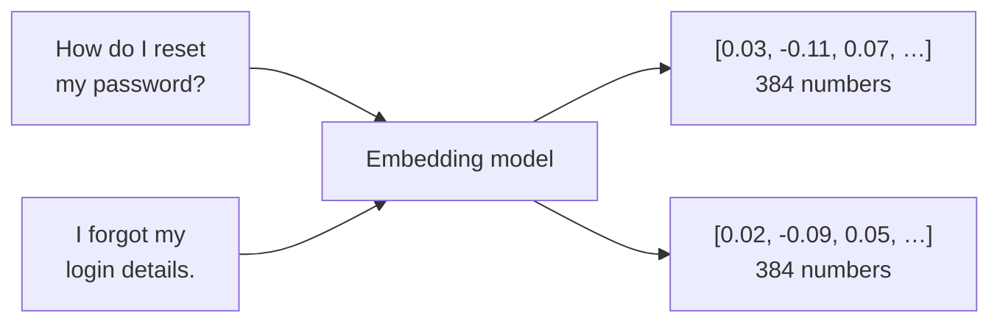
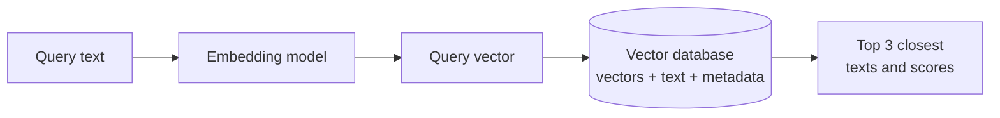
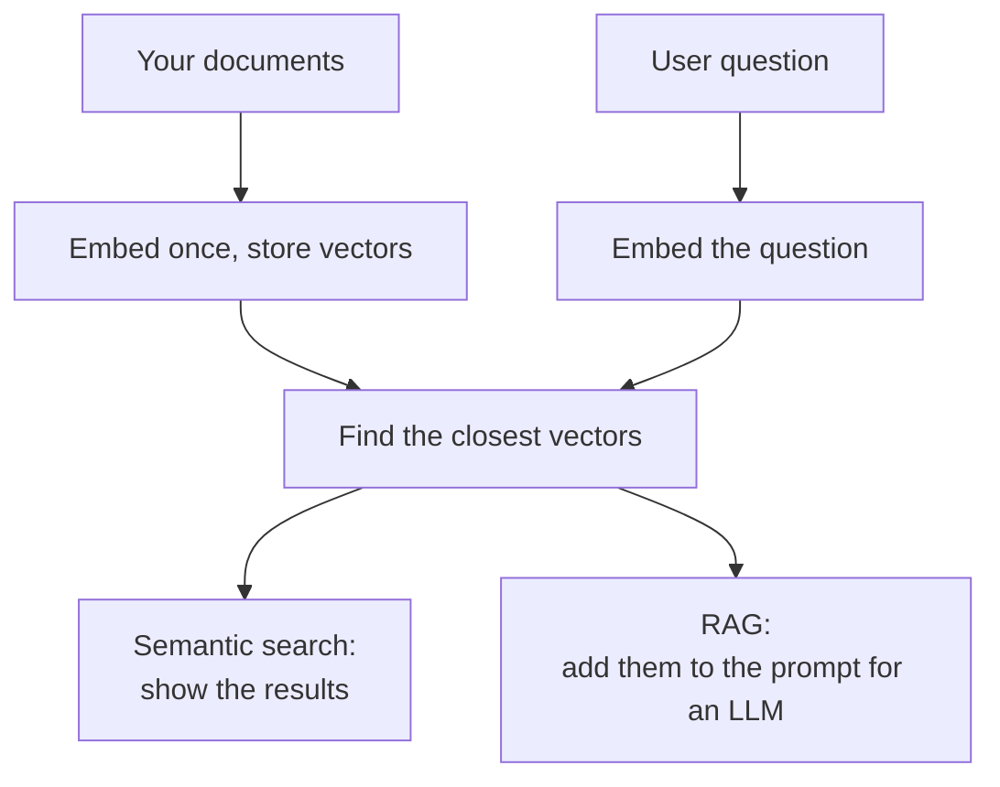

An embedding is a list of numbers that captures what a piece of text means. An embedding model turns "How do I reset my password?" into a few hundred numbers, and turns "I forgot my login details" into numbers that are close to them, because the meaning is close. Your code can then find related text by comparing numbers, even when the words are different.

A vector database stores these lists and finds the closest ones quickly. Together, they are what makes semantic search and RAG work. This post explains both in plain words, and you'll compare sentences on your own machine at the end.

## What is an embedding?

An embedding is the output of an embedding model: a fixed-length list of numbers for any text you give it. The list is also called a vector. Anthropic's [embeddings guide](https://platform.claude.com/docs/en/build-with-claude/embeddings) calls them "numerical representations of text that enable measuring semantic similarity". Semantic means "about meaning".



The numbers in the diagram are illustrative. Real ones come from the model, as you'll see in the hands-on step.

A helpful picture is a map. A city's coordinates are two numbers, and nearby cities have similar coordinates. An embedding is like coordinates for meaning. It just uses many more numbers than two: the small model in this post uses 384, and [Voyage AI's](https://platform.claude.com/docs/en/build-with-claude/embeddings) current models use 1,024 by default. You can't read much from a single number on its own. What matters is how two lists compare.

## Why do similar texts get similar numbers?

Because the model was trained to do exactly that. The model used in this post, [all-MiniLM-L6-v2](https://huggingface.co/sentence-transformers/all-MiniLM-L6-v2), was trained on over a billion pairs of related sentences, such as a question and its answer, or two ways of asking the same question. During training, it learned to place each sentence close to its partner and away from random other sentences.

The result: texts that mean similar things end up near each other, even when they share no words. "I cannot sign in" and "reset my password" are close. "Cats sleep a lot" is far from both.

## How do you measure how close two embeddings are?

The most common measure is **cosine similarity**. Think of each embedding as an arrow from the center of the map. Cosine similarity asks one question: do the two arrows point the same way?

- **1** means they point in exactly the same direction: very similar meaning.
- **0** means they are at a right angle: unrelated.
- **-1** means they point in opposite directions.

Here is a tiny example with two numbers per vector instead of 384:

| Vectors | Picture | Cosine similarity |
| --- | --- | --- |
| A = [1, 2] and B = [2, 4] | B is A, twice as long | 1.0 |
| A = [1, 2] and C = [2, 1] | Close, but not the same way | 0.8 |
| A = [1, 2] and D = [2, -1] | At a right angle | 0.0 |

To compute it, multiply the numbers pair by pair and add them up (the dot product), then divide by the two arrows' lengths. For A and C: (1 × 2 + 2 × 1) / (√5 × √5) = 4 / 5 = 0.8. Notice that A and B score 1.0 even though B is longer. Cosine similarity only cares about direction, not size.

A shortcut you'll see a lot: many tools normalize embeddings, which means they scale every vector to length 1. Then the lengths are both 1, and cosine similarity is just the dot product. The [embeddings guide](https://platform.claude.com/docs/en/build-with-claude/embeddings) notes this for Voyage embeddings, and the hands-on step below uses the same option.

## Try it: compare sentences on your machine

You'll embed six short sentences and one question with a small open model, and print which sentences are closest in meaning. It runs locally with no API key and no account.

**You need:** [Node.js](https://nodejs.org) 22 and a terminal in an empty folder. The first run downloads the model (about 90 MB) from Hugging Face; later runs use the cached copy.


<Steps>


<Step title="Install Transformers.js">


```bash
npm install @huggingface/transformers
```


[Transformers.js](https://huggingface.co/docs/transformers.js/index) is Hugging Face's library for running AI models in JavaScript. It works in Node.js and in the browser.

</Step>


<Step title="Create the script">


**embeddings.mjs**

```js
import { pipeline } from '@huggingface/transformers';

// Load a small embedding model (downloads about 90 MB the first time)
const embed = await pipeline('feature-extraction', 'onnx-community/all-MiniLM-L6-v2-ONNX');

const sentences = [
  'How do I reset my password?',
  'I forgot my login details.',
  'The build fails after upgrading Node.',
  'Our CI pipeline broke this morning.',
  'What is the best pizza topping?',
  'Cats sleep for most of the day.',
];
const query = 'I cannot sign in to my account';

// One call embeds the query and all the sentences
const output = await embed([query, ...sentences], { pooling: 'mean', normalize: true });
const [queryVector, ...sentenceVectors] = output.tolist();

console.log(`Each embedding has ${queryVector.length} numbers.`);
console.log(`The query starts with: ${queryVector.slice(0, 4).map((n) => n.toFixed(3)).join(', ')} …\n`);

// Cosine similarity: dot product divided by the two lengths
const dot = (a, b) => a.reduce((sum, value, i) => sum + value * b[i], 0);
const length = (v) => Math.sqrt(dot(v, v));
const cosineSimilarity = (a, b) => dot(a, b) / (length(a) * length(b));

const ranked = sentences
  .map((text, i) => ({ text, score: cosineSimilarity(queryVector, sentenceVectors[i]) }))
  .sort((a, b) => b.score - a.score);

console.log(`Query: "${query}"`);
for (const { text, score } of ranked) {
  console.log(`${score.toFixed(2).padStart(6)}  ${text}`);
}
```


- `pipeline('feature-extraction', …)` loads the embedding model. The model name is the same one used in the [Transformers.js docs](https://huggingface.co/docs/transformers.js/api/pipelines).
- `pooling: 'mean'` averages the model's output for each token (a small piece of a word) into one vector per sentence. `normalize: true` scales each vector to length 1.
- `cosineSimilarity` is the formula from the section above, in three lines.

</Step>


<Step title="Run it">

```bash
$ node embeddings.mjs
```

You should see:

```text
Each embedding has 384 numbers.
The query starts with: 0.016, -0.042, -0.031, -0.029 …

Query: "I cannot sign in to my account"
  0.55  How do I reset my password?
  0.47  I forgot my login details.
  0.16  The build fails after upgrading Node.
  0.10  Our CI pipeline broke this morning.
  0.02  What is the best pizza topping?
 -0.02  Cats sleep for most of the day.
```

</Step>


<Step title="Read the result">

- **The two login sentences win**, even though neither contains "sign in" or "account". That's meaning, not keyword matching.
- **The build and CI sentences come next.** They are about software problems, so they are a bit closer than pizza or cats.
- **Unrelated sentences land near 0**, not at -1. Unrelated text isn't the opposite of your question; it's just about something else.

Change `query` to "my tests are red after the update" and run it again. The build and CI sentences move to the top.

</Step>


</Steps>


## What does a vector database do?

A vector database stores embeddings, each with its text and any extra data you want (such as a file name or a date), and answers one question fast: "which stored vectors are closest to this one?" That question is called a nearest-neighbor search.



Comparing the query with every stored vector gives exact results, but gets slow with millions of vectors. So vector databases also build indexes for approximate search. For example, [pgvector](https://github.com/pgvector/pgvector), an open-source extension that adds vector search to Postgres, supports both "exact and approximate nearest neighbor search". Its README explains that an approximate index, such as HNSW or IVFFlat, "trades some recall for speed": search gets much faster, but it may miss a close match now and then.

With pgvector, a similarity search is a normal SQL query. The `<=>` operator is cosine distance, so the smallest values are the closest:

```sql
SELECT * FROM items ORDER BY embedding <=> '[3,1,2]' LIMIT 5;
```

Besides speed, a database gives you the usual database things: filtering (only search docs from this team), updates and deletes, and many readers and writers at once.

## When is a simple array enough?

More often than you'd think. For each question, you compare one vector with every stored vector and keep the best few. For small data, that's fast.

In our test on Node 22, comparing a query with **10,000** stored vectors of 384 numbers each, in a plain JavaScript array, took **10 to 50 ms** per search. 100,000 vectors took about 150 ms. Your numbers will vary with your machine, but the scale is the point.

| | Array in memory (or a JSON file) | Vector database |
| --- | --- | --- |
| Setup | None | A service or extension to run |
| Good for | Up to tens of thousands of chunks, one app | Millions of vectors, many users |
| Search | Exact, compares everything | Exact or approximate, with indexes |
| Filters and updates | Write them yourself | Built in |

Start with the array. Move to a vector database when search gets slow, the data no longer fits in memory, or you need filters and many writers. If you already run Postgres, pgvector lets you keep vectors next to the rest of your data.

## How do embeddings power semantic search and RAG?

**Semantic search** is search by meaning. You embed every document once and store the vectors. For each search, you embed the query and return the closest documents. A user who types "can't sign in" finds the page titled "Reset your password". Anthropic's guide also lists recommendations and anomaly detection as uses: similar items are close, and an odd one out is far from everything.

**RAG** (retrieval-augmented generation) uses the same search as its first step. It finds the chunks of your docs that are closest to a user's question, puts them into the prompt, and lets an AI model answer from them. [What is RAG?](/blog/what-is-rag) explains that flow.



If you're new to LLMs, start with [What is an LLM?](/blog/what-is-an-llm) first.

## What should I watch out for?


<Callout type="warning" title="Use one model for documents and questions">

Each embedding model has its own number space, often with a different length (384 numbers here, 1,024 for Voyage's default). A question embedded with one model can't be compared with documents embedded by another. If you switch models, re-embed all your documents.

</Callout>


- **Input length.** Models only read so much text. [all-MiniLM-L6-v2](https://huggingface.co/sentence-transformers/all-MiniLM-L6-v2) cuts off input longer than 256 word pieces. Split long documents into chunks before you embed them.
- **Language.** The model in this post was trained on English. For other languages, pick a multilingual model, such as Voyage's, which its docs describe as optimized for multilingual retrieval.
- **Exact terms.** Embeddings match meaning, so they can miss exact strings like an error code. Anthropic's [Contextual Retrieval](https://www.anthropic.com/engineering/contextual-retrieval) article shows a search for "TS-999" missing the exact entry, and pairs embeddings with keyword search (BM25) to fix it.
- **Choosing a model.** Anthropic doesn't offer its own embedding model; its [guide](https://platform.claude.com/docs/en/build-with-claude/embeddings) uses Voyage AI and suggests comparing providers on domain fit, speed and customization. A small local model like the one here is a great way to learn and prototype.

## What should I do next?

- **Swap in your own sentences.** Paste a few titles from your docs or issue tracker into the script and search them with real questions.
- **Build a RAG app.** [How to build your first RAG app](/blog/build-your-first-rag-app) uses these same embeddings to answer questions from a folder of Markdown notes with Claude.
- **Read the [Transformers.js feature-extraction docs](https://huggingface.co/docs/transformers.js/api/pipelines)** to see other options, such as smaller binary embeddings.
