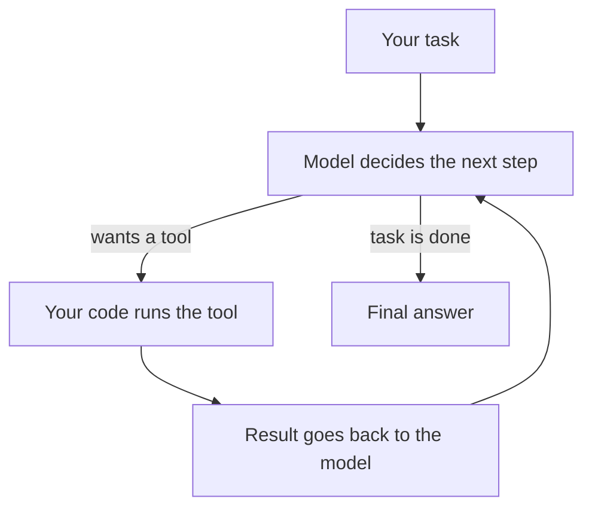
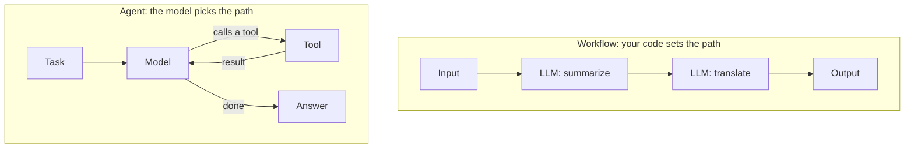

An AI agent is an LLM that uses tools in a loop: it picks an action, looks at the result, and decides what to do next, until the task is done. Anthropic puts it in one line in [Building effective agents](https://www.anthropic.com/engineering/building-effective-agents): agents "are typically just LLMs using tools based on environmental feedback in a loop."

That is the whole idea. A chat model gives you one answer. An agent can run the tests, read the error, change the code and run the tests again, all from one request. This post explains how that loop works, when it is the right choice, and when a simpler setup is better.

If terms like LLM, token or context window are new, read [What is an LLM?](/blog/what-is-an-llm) first.

## How does an AI agent work?

An LLM on its own can only write text. To act, it needs **tools**: functions your app offers it, such as "read a file" or "run the tests". The model never runs a tool itself. It replies with a request like "call `run_tests`", your code runs it, and the result goes back to the model. The [tool use docs](https://platform.claude.com/docs/en/agents-and-tools/tool-use/how-tool-use-works) describe this: "The model never executes anything on its own."

An agent repeats that round trip until the job is done:



The result of each step is the "feedback" in Anthropic's definition. It is how the agent learns what happened. Anthropic calls it "ground truth" from the environment: a test result, a file's contents, an error message. Without it, the model would only be guessing.

Here is what that looks like when you ask a coding agent to "fix the failing tests". The [Claude Code docs](https://code.claude.com/docs/en/how-claude-code-works) list these steps:

1. Run the test suite to see what's failing
2. Read the error output
3. Search for the relevant source files
4. Read those files to understand the code
5. Edit the files to fix the issue
6. Run the tests again to verify

Nobody wrote those six steps in advance. The model chose each one after it saw the result of the one before.

## What is the difference between a workflow and an agent?

Not every app that uses an LLM and tools is an agent. Anthropic splits these "agentic systems" into two kinds ([source](https://www.anthropic.com/engineering/building-effective-agents)):

- **Workflows** are "systems where LLMs and tools are orchestrated through predefined code paths."
- **Agents** are "systems where LLMs dynamically direct their own processes and tool usage, maintaining control over how they accomplish tasks."

In plain words: in a workflow, **your code** decides the steps. In an agent, **the model** decides them.



| | Workflow | Agent |
| --- | --- | --- |
| Who picks the next step | Your code | The model |
| Number of steps | Fixed, known in advance | Unknown until it runs |
| Behavior | Predictable, easy to test | Flexible, harder to test |
| Good for | Well-defined tasks, like "summarize, then translate" | Open-ended tasks, like "fix this bug" |

Both are useful. A workflow is not a weaker agent; for many tasks it is the better choice.

## What are the parts of an agent?

Every agent, from a 50-line script to Claude Code, has the same six parts.

| Part | What it is | Example in a coding agent |
| --- | --- | --- |
| Model | The LLM that decides what to do next | A Claude model |
| Tools | Functions the model can ask your app to run | Read a file, edit a file, run a shell command |
| Loop | The code that runs tools and sends results back | Repeat while the model asks for a tool |
| Instructions | The task and the rules, in the prompt | "Fix the failing tests. Don't change the test files." |
| Memory (context) | Everything the model can see: the task, each tool call and each result | The conversation so far, plus a project file like `CLAUDE.md` |
| Stopping and limits | When the loop ends | The model says it is done, or a step or budget limit is hit |

Two of these need a closer look.

**Memory is the context window.** The model keeps nothing between API calls, so the loop sends the whole history each time: the task, every tool call and every result. That history grows with each step. Long tasks can fill the context window, so agents trim or summarize old steps. Claude Code, for example, "clears older tool outputs first, then summarizes the conversation if needed" ([docs](https://code.claude.com/docs/en/how-claude-code-works)).

**Stopping needs a rule.** Most of the time the agent stops because the model says the task is done. With the Claude API, that is when the response no longer asks for a tool: the loop continues "while `stop_reason` is `tool_use`" ([docs](https://platform.claude.com/docs/en/agents-and-tools/tool-use/how-tool-use-works)). But a model can also go around in circles. That is why Anthropic notes it is "common to include stopping conditions (such as a maximum number of iterations) to maintain control." The Claude Agent SDK, for example, has `maxTurns` and `maxBudgetUsd` options for exactly this ([docs](https://code.claude.com/docs/en/agent-sdk/agent-loop)).

## What does an AI agent look like in practice?

You may already use one.

- **Coding agents.** [Claude Code](https://code.claude.com/docs/en/how-claude-code-works) runs in your terminal. It works in three phases, "gather context, take action, and verify results", using tools for files, search, shell commands and the web. Its docs call the layer around the model, which provides the tools and manages the context, the "agentic harness".
- **Customer support.** Anthropic names support as a good fit for agents: a chat interface plus tools that pull customer data and order history, and actions such as issuing refunds or updating tickets ([source](https://www.anthropic.com/engineering/building-effective-agents)).
- **Agents you build.** The [Claude Agent SDK](https://code.claude.com/docs/en/agent-sdk/overview) gives you "the same tools, agent loop, and context management that power Claude Code" as a library for Python and TypeScript. [Claude Managed Agents](https://platform.claude.com/docs/en/managed-agents/overview), in beta, runs the loop for you on Anthropic's infrastructure.

Many agents also get tools from **MCP servers**. MCP is a standard way to plug tools into AI apps; see [What is MCP?](/blog/what-is-mcp).

## When should I use an agent?

Anthropic's advice is to find "the simplest solution possible, and only increasing complexity when needed" ([source](https://www.anthropic.com/engineering/building-effective-agents)). Often the simplest solution is not an agent.

| Your task | Best fit | Why |
| --- | --- | --- |
| Answer a question from text you already have | One prompt | No tools, no loop needed |
| The same fixed steps every time, like "extract fields, then translate" | A workflow | Predictable, cheaper, easier to test |
| An open-ended task where you can't know the steps in advance, like "fix this bug" | An agent | The model needs to react to each result |

Anthropic describes the agent case as "open-ended problems where it's difficult or impossible to predict the required number of steps, and where you can't hardcode a fixed path." A quick test: if you can write the steps down as a checklist before you start, write a workflow.

## What can go wrong with AI agents?

Agents are powerful because they act on their own. That is also why they need care. Anthropic warns that "the autonomous nature of agents means higher costs, and the potential for compounding errors."

- **Cost and time.** Every step is another model call, and each call sends the growing history. A task that takes 30 steps costs far more than one prompt.
- **Errors that compound.** If step 2 reads the wrong file, every later step builds on that mistake. A small error early can send the agent far off course.
- **Safety.** An agent with a shell or write access can delete files, push code or call APIs. Text it reads from outside, like a web page or an issue comment, can contain hidden instructions that try to steer it. This is called [prompt injection](https://genai.owasp.org/llmrisk/llm01-prompt-injection/).


<Callout type="warning" title="Keep a human in the loop">

Give an agent only the tools and access it needs. Keep approvals on for actions you can't undo, like deleting data, deploying or sending messages. Set a step or budget limit. Anthropic recommends "extensive testing in sandboxed environments, along with the appropriate guardrails" before you trust an agent with more.

</Callout>


Good agent tools help here. Claude Code asks before it edits files or runs commands in its Manual permission mode, snapshots files before it edits them so you can rewind, and lets you press `Esc` at any time to stop it ([docs](https://code.claude.com/docs/en/how-claude-code-works)). File checkpoints can't undo actions on remote systems, such as databases or deployments, so those need the most care.

## Try it: run a tiny agent loop

You'll run the whole agent loop on your own machine, in about 50 lines of JavaScript. The "model" here is a stand-in with simple rules, so it runs without an API key or account. Everything else, the tools, the loop, the memory and the step limit, follows the same pattern as a real agent.

**You need:** [Node.js](https://nodejs.org) (we used Node 22) and a terminal in an empty folder.


<Steps>


<Step title="Create the script">


**agent-loop.mjs**

```js
// A tiny agent loop. The "model" is a stand-in, so this runs without an API key.

// The world the agent works in: two files, one with a bug.
const files = {
  'src/math.js': 'export const add = (a, b) => a - b;',
  'README.md': '# Demo project',
};

// Tools: plain functions the loop can run for the model.
const tools = {
  run_tests: () =>
    files['src/math.js'].includes('a + b')
      ? 'PASS: add(2, 3) returned 5'
      : 'FAIL: add(2, 3) returned -1, expected 5',
  read_file: ({ path }) => files[path] ?? `Error: no file named ${path}`,
  write_file: ({ path, content }) => {
    files[path] = content;
    return `Wrote ${path}`;
  },
};

// Stand-in for the LLM. A real model reads the whole conversation and
// decides the next step. This one follows simple rules based on the last result.
function fakeModel(messages) {
  const last = messages.at(-1).content;
  if (messages.length === 1) return { tool: 'run_tests', input: {} };
  if (last.startsWith('FAIL')) return { tool: 'read_file', input: { path: 'src/math.js' } };
  if (last.includes('a - b')) {
    return { tool: 'write_file', input: { path: 'src/math.js', content: last.replace('a - b', 'a + b') } };
  }
  if (last.startsWith('Wrote')) return { tool: 'run_tests', input: {} };
  if (last.startsWith('PASS')) return { answer: 'Fixed add() in src/math.js. The test passes.' };
  return { answer: 'I am stuck. A human should take a look.' };
}

// The loop: ask the model, run the tool it picks, feed the result back.
const MAX_STEPS = 10;
const messages = [{ role: 'user', content: 'The tests fail. Fix the bug.' }];

for (let step = 1; step <= MAX_STEPS; step++) {
  const decision = fakeModel(messages);

  if (decision.answer) {
    console.log(`Done after ${step - 1} tool calls: ${decision.answer}`);
    process.exit(0);
  }

  const result = tools[decision.tool](decision.input);
  console.log(`Step ${step}: ${decision.tool}(${JSON.stringify(decision.input)})`);
  console.log(`  -> ${result}`);
  messages.push({ role: 'tool', content: result });
}

console.log(`Stopped: reached the limit of ${MAX_STEPS} steps.`);
```


Find the six parts: `fakeModel` is the model, `tools` are the tools, the `for` loop is the loop, the first message holds the instructions, `messages` is the memory, and `MAX_STEPS` is the limit.

</Step>


<Step title="Run it">

```bash
$ node agent-loop.mjs
```

You should see:

```text
Step 1: run_tests({})
  -> FAIL: add(2, 3) returned -1, expected 5
Step 2: read_file({"path":"src/math.js"})
  -> export const add = (a, b) => a - b;
Step 3: write_file({"path":"src/math.js","content":"export const add = (a, b) => a + b;"})
  -> Wrote src/math.js
Step 4: run_tests({})
  -> PASS: add(2, 3) returned 5
Done after 4 tool calls: Fixed add() in src/math.js. The test passes.
```

Each step depends on the result before it. The agent only reads the file because the test failed, and only stops because the test passed.

</Step>


<Step title="Hit the limit">

Change `const MAX_STEPS = 10;` to `const MAX_STEPS = 2;` and run it again:

```text
Step 1: run_tests({})
  -> FAIL: add(2, 3) returned -1, expected 5
Step 2: read_file({"path":"src/math.js"})
  -> export const add = (a, b) => a - b;
Stopped: reached the limit of 2 steps.
```

The task isn't finished, but the loop stopped anyway. That is what a step limit is for: a stuck agent can't run forever.

</Step>


<Step title="Compare it with a real agent">

In a real agent, `fakeModel` becomes a call to an LLM API. With the Claude API, you send the tools with the request; the response asks for a tool with a `tool_use` block, and you send the result back in a `tool_result` block. The loop keeps going while the response's `stop_reason` is `tool_use`. The [tool use docs](https://platform.claude.com/docs/en/agents-and-tools/tool-use/overview) show that round trip in full.

If you use [Claude Code](https://code.claude.com/docs/en/setup), you can watch the same loop live: give it a small task in a test project and see each tool call as it works. Press `Ctrl+O` to open the transcript viewer, which "shows detailed tool usage and execution", and press `Esc` to stop it mid-step ([shortcuts](https://code.claude.com/docs/en/interactive-mode)).

</Step>


</Steps>


## What should I do next?

- **Read [What is MCP?](/blog/what-is-mcp)** to see where many agents get their tools, and connect your first MCP server.
- **Read Anthropic's [Building effective agents](https://www.anthropic.com/engineering/building-effective-agents)** for the workflow patterns (prompt chaining, routing and others) to try before you reach for a full agent.
- **Build a real one.** [How to build your first AI agent in Node.js](/blog/build-your-first-ai-agent) builds the same loop with the real Claude API. [What is tool calling?](/blog/what-is-tool-calling) explains how the model asks for a tool.
- **Next in this series:** [AI agents vs MCP](/blog/ai-agents-vs-mcp), and how the two fit together.
