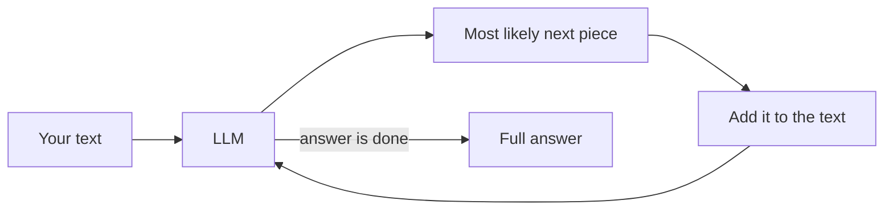
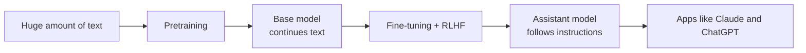

An LLM (large language model) is a program trained on a huge amount of text that writes by predicting what comes next. It is the engine inside ChatGPT, Claude and similar apps. You give it text, and it continues that text one small piece at a time, until it has written an answer.

If you use AI chat apps to answer questions or write code, you already use an LLM every day. This post explains what happens inside, in plain words, so the rest of AI makes sense.

## What does an LLM actually do?

It predicts the next piece of text. Give it "The capital of France is" and the most likely next piece is " Paris". Then it adds that piece to the text and predicts the next one, and the next, until the answer is done.



That's the whole trick. It sounds too simple to write code or explain an error message, but after training on enough text, predicting the next piece well means the model has picked up grammar, facts, code patterns and how answers are usually shaped. [Anthropic's glossary](https://platform.claude.com/docs/en/about-claude/glossary) describes models as being trained "to predict the next word, given the previous context".

## What is a token?

A token is the small piece of text an LLM reads and writes. It can be a whole word, part of a word, a space plus a word, or a symbol. For Claude, a token is about 3.5 English characters on average, according to the [glossary](https://platform.claude.com/docs/en/about-claude/glossary).

Here is how one sentence splits into tokens with the tokenizer used by several OpenAI models, such as GPT-5 and GPT-4o:

```text
Developers love clear error messages.
[Develop] [ers] [ love] [ clear] [ error] [ messages] [.]
```

Seven tokens. Common words are one token; a longer word like "Developers" becomes two. Each model family splits text its own way, so the same sentence can be a different number of tokens in another model.

Tokens matter to you for two reasons:

- **Limits.** How much a model can read and write at once is counted in tokens.
- **Cost.** APIs charge per token, for the tokens you send and the tokens you get back.

You'll split a sentence yourself in the hands-on step at the end.

## How is an LLM made?

In two main stages.

1. **Pretraining.** The model reads a huge amount of text and learns to predict the next word. The result is a base model: good at continuing text, but not good at following instructions or answering questions.
2. **Fine-tuning.** The base model is trained further to be a helpful assistant. One common method is RLHF (reinforcement learning from human feedback): people rank answers, and the model learns to prefer the better ones.



Anthropic's [glossary](https://platform.claude.com/docs/en/about-claude/glossary) describes this path for Claude: a pretrained model, then fine-tuning and RLHF to make it a helpful assistant.

You won't train a model like this yourself. It takes huge amounts of data and computing power. As a developer, you use a finished model through an app or an API.

## What is the context window?

The context window is the model's working memory: everything it can look at while it writes. That includes your instructions, the conversation so far, any files or data you pasted, and the answer it is writing. The [context window docs](https://platform.claude.com/docs/en/build-with-claude/context-windows) spell this out.

It is measured in tokens. Current Claude models have a context window of up to 1 million tokens, which Anthropic puts at roughly 555,000 words ([models overview](https://platform.claude.com/docs/en/about-claude/models/overview)). Other models have smaller or larger windows.

Two things surprise most developers:

- **Bigger is not always better.** The same docs note that accuracy can drop as the context gets very long. Send what the model needs, not everything you have.
- **The model keeps no memory between API calls.** Anthropic's API is [stateless](https://platform.claude.com/docs/en/build-with-claude/working-with-messages): your app sends the whole conversation with every request. A chat app feels like it remembers because it resends the history for you.

## Why does the same question give different answers?

Because the model doesn't always pick the single most likely next token. It picks from the likely ones, with some randomness. That is why "suggest a name for my project" gives a new list each time.

Many APIs expose a setting called **temperature** to control this: lower gives steadier answers, higher gives more varied ones. Some newer models no longer let you change it. On Claude's latest models, for example, setting it returns an error, and you [guide the answer with your prompt](https://platform.claude.com/docs/en/build-with-claude/working-with-messages) instead.

Even at the steadiest setting, answers are not guaranteed to be identical every time, as the [glossary](https://platform.claude.com/docs/en/about-claude/glossary) notes. Don't build code that expects the exact same text twice.

## Why does an LLM make things up?

An LLM writes the most likely text. It does not look facts up in a database. When it lacks the right information, the most likely-sounding answer can still be wrong, and it says it with the same confidence. This is called [hallucination](https://platform.claude.com/docs/en/test-and-evaluate/strengthen-guardrails/reduce-hallucinations).

Two gaps cause most of it:

- **Knowledge cutoff.** A model learned from text up to a certain date. Every Claude model lists its "reliable knowledge cutoff" in the [models overview](https://platform.claude.com/docs/en/about-claude/models/overview). It doesn't know what happened after that unless you tell it.
- **Your private data.** It never saw your code, your tickets or your company docs.


<Callout type="warning" title="Check before you trust">

Treat an LLM's answer like a confident colleague's first draft. For facts, versions, API names and anything that matters, check the source. Anthropic's own guide suggests letting the model say "I don't know" and asking it to quote the sources it used.

</Callout>


## What can't an LLM do on its own?

Out of the box, an LLM only turns text into more text. Everything else is added around it.

| On its own, an LLM can't… | What developers add |
| --- | --- |
| Know recent events or your private data | Put the data in the prompt, or use [RAG](/blog/what-is-rag) to find it for each question |
| Remember earlier API calls | Send the conversation history with each request |
| Take actions, like searching issues or running code | [Tool calling](/blog/what-is-tool-calling), often through [MCP](/blog/what-is-mcp) |
| Guarantee a correct answer | Checks, tests ([evals](/blog/test-ai-output-with-evals)) and a human in the loop |

The rest of this series covers each of these, one post at a time.

## Try it: split text into tokens

You'll see exactly how a model breaks your own text into tokens. It runs on your machine with no API key and no account.

**You need:** a recent version of [Node.js](https://nodejs.org) (we used Node 22) and a terminal in an empty folder.


<Steps>


<Step title="Install the tokenizer">


```bash
npm install gpt-tokenizer
```


This installs [gpt-tokenizer](https://www.npmjs.com/package/gpt-tokenizer), an open-source JavaScript library that splits text the same way several OpenAI models do.

</Step>


<Step title="Create the script">


**tokens.mjs**

```js
import { encode, decode } from 'gpt-tokenizer';

const text = 'Developers love clear error messages.';
const tokens = encode(text);

console.log(`${tokens.length} tokens`);
console.log(tokens.map((t) => `[${decode([t])}]`).join(' '));
```


`encode` turns text into token IDs (numbers). `decode` turns each ID back into its piece of text, so you can see where the splits are.

</Step>


<Step title="Run it">

```bash
$ node tokens.mjs
```

You should see:

```text
7 tokens
[Develop] [ers] [ love] [ clear] [ error] [ messages] [.]
```

</Step>


<Step title="Try your own text">

Change `text` to a line of code, a sentence in another language, or a long rare word. Code and non-English text often take more tokens than you'd expect, which means they fill the context window faster and cost more.

</Step>


</Steps>


## What should I do next?

- **Read [What is MCP?](/blog/what-is-mcp)** to see how an LLM gets tools to act on your real systems.
- **Count the tokens in a prompt you use often.** Paste it into the script above and see how big it really is.
- **Next in this series:** [Your first LLM API call](/blog/first-llm-api-call), where you call a model from your own code.
