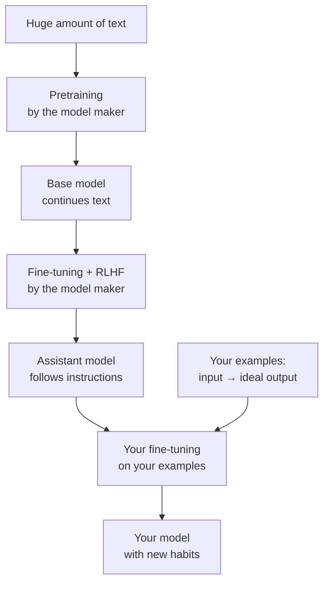
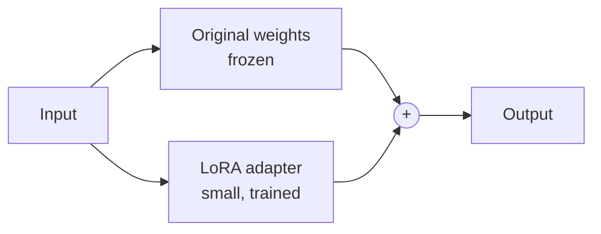
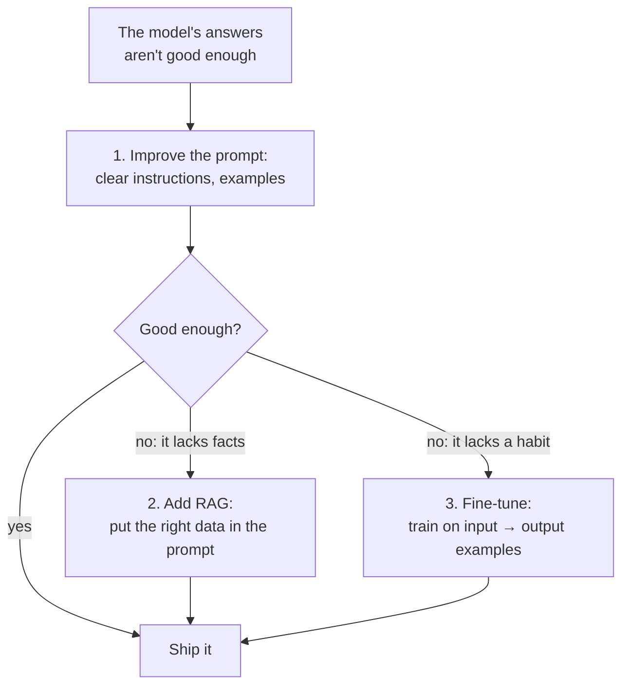

Fine-tuning means training an existing AI model a little more on your own examples, so it picks up new habits: a writing style, an output format, or one narrow task. You don't change the prompt; you change the model itself. It is powerful, but it is usually the last tool to reach for, after a better prompt and RAG.

This post explains what fine-tuning changes, what it can't do, how LoRA makes it cheaper, and how to decide whether you need it at all.

## How is fine-tuning different from pretraining?

If you read [What is an LLM?](/blog/what-is-an-llm), you already know the first two stages of making a model: pretraining on a huge amount of text, then fine-tuning to turn the result into a helpful assistant. Fine-tuning as a developer is one more round of the same idea, on a much smaller scale, with your own examples.



Anthropic's [glossary](https://platform.claude.com/docs/en/about-claude/glossary) defines fine-tuning as "further training a pretrained language model using additional data", which makes the model start "mimicking the patterns and characteristics of the fine-tuning dataset".

A simple way to picture it: pretraining is years of school. Fine-tuning is a short training course at a new job. The course doesn't teach you to read. It teaches you how this team writes its reports.

## What does fine-tuning change?

Fine-tuning is good at teaching **how** to answer. OpenAI's [fine-tuning guide](https://developers.openai.com/api/docs/guides/supervised-fine-tuning) lists jobs like these:

- **Format.** Always reply with the same JSON shape, or the same report layout.
- **Style and tone.** Write like your brand, or like your senior engineers.
- **A narrow task.** Classify tickets, tag documents, or translate in a special domain.
- **Following instructions.** Do the thing reliably when prompts alone keep missing.

Here is a real example from [How to fine-tune your first model](/blog/fine-tune-your-first-model). We asked a tiny open model, [SmolLM2-135M-Instruct](https://huggingface.co/HuggingFaceTB/SmolLM2-135M-Instruct), to turn a support note into JSON. Then we fine-tuned it on 32 examples and asked again.

| | Model output for "I paid but my plan still says Free." |
| --- | --- |
| Before, note only | `I'm sorry for the confusion, but as a helpful AI, I don't have the ability to provide plans…` |
| Before, with a JSON instruction in the prompt | `{"category": "billing", "priority": "high"}}` (an extra brace, so the JSON is invalid) |
| After fine-tuning, note only | `{"category": "billing", "priority": "normal"}` |

After fine-tuning, the model answered in valid JSON for all three test notes, with no instructions in the prompt. It learned the habit. It did not learn good judgement: the priority was wrong in all three test notes. Thirty-two examples teach a format; judgement needs more and better examples.

## What doesn't fine-tuning do well?

It is a poor way to add **facts**, especially facts that change.

A [2023 study](https://arxiv.org/abs/2312.05934) found that models "struggle to learn new factual information through unsupervised fine-tuning", and that RAG "consistently outperforms it". RAG (retrieval-augmented generation) finds the relevant pieces of your data for each question and puts them into the prompt. The [glossary](https://platform.claude.com/docs/en/about-claude/glossary) notes that RAG is useful for "up-to-date information, domain-specific knowledge, or explicit citation of sources".

There are practical reasons too:

- **Facts change.** Your docs change every week. You'd have to train again each time.
- **No sources.** A fine-tuned model can't tell you which document an answer came from. RAG can.
- **Still guessing.** A model that saw a fact during training can still get it wrong, just as an LLM can [make things up](/blog/what-is-an-llm) today.

So: facts go in the prompt, habits go in the weights. [What is RAG?](/blog/what-is-rag) covers the facts side.

## What is LoRA, and how is it different from full fine-tuning?

A model is a large set of numbers, called weights. There are two main ways to fine-tune it.

**Full fine-tuning** updates every weight. You end up with a complete new copy of the model. For big models, that takes a lot of GPU memory and storage.

**Parameter-efficient fine-tuning** (PEFT) trains only a small number of extra weights and leaves the original model frozen. The Hugging Face [PEFT docs](https://huggingface.co/docs/peft/index) say this gives results "comparable to a fully fine-tuned model" at a fraction of the cost. The most common method is **LoRA** (low-rank adaptation).



LoRA adds a small side path, called an **adapter**, next to parts of the model. Only the adapter learns. At the end, the model's answer is the frozen part plus the adapter's small correction. The [LoRA paper](https://arxiv.org/abs/2106.09685) reports that, for GPT-3 175B, LoRA cut the number of trainable weights by 10,000 times and the GPU memory needed by 3 times, with no extra delay when the model answers.

| | Full fine-tuning | LoRA |
| --- | --- | --- |
| What trains | Every weight | A small adapter; the model is frozen |
| What you store | A full copy of the model | Just the adapter file |
| Hardware | Large GPUs for big models | Much less; tiny models even train on a CPU |
| Switching tasks | Load a different model | Swap the adapter on the same base model |

In our example, LoRA trained 4.9 million of the model's 139 million weights (3.5%). The saved adapter was 19.6 MB, next to 269 MB for the model itself.

## What data do you need?

Examples of **input → ideal output**. Each example shows the model a real input and the exact answer you want. For a chat model, one example often looks like this, one per line in a JSONL file:

```json
{"prompt": [{"role": "user", "content": "I was charged twice for my March invoice."}], "completion": [{"role": "assistant", "content": "{\"category\": \"billing\", \"priority\": \"high\"}"}]}
```

This is the prompt-completion format that Hugging Face's [TRL library](https://huggingface.co/docs/trl/sft_trainer) accepts. Other tools use similar shapes.

How many? OpenAI's [guide](https://developers.openai.com/api/docs/guides/supervised-fine-tuning) says it sees improvements from 50 to 100 examples, and suggests starting with 50 well-crafted ones. Three rules matter more than the count:

- **Consistent.** If two similar notes get different labels, the model learns confusion.
- **Realistic.** Examples should look like the inputs you'll really get, including the messy ones.
- **Held out.** Keep some examples out of training, so you can test the model on inputs it has never seen. The same guide says: set up good tests (evals) before you invest in fine-tuning.

## What does fine-tuning cost, and what can go wrong?

The training run is often the cheap part. The real costs are:

- **Your time** to collect, clean and label good examples.
- **Compute** to train, often a rented GPU for anything beyond a tiny model.
- **Testing** every new version against your held-out examples.
- **Running the model.** With an open model, you host it or pay someone to.
- **Upkeep.** When a better base model ships, you fine-tune again to get your habits back.

And the risks:

- **Forgetting.** A model can lose some of what it knew. One [study](https://arxiv.org/abs/2401.05605) found that LoRA "still suffer[s] from catastrophic forgetting", and looked at how this affects a model's safety guardrails.
- **Leaking your data.** Models can memorize and repeat training text; [researchers extracted](https://arxiv.org/abs/2012.07805) names, phone numbers and email addresses from one model's training data. Remove secrets and personal data from your examples first.
- **Licences.** An open model comes with a licence, and so does any dataset you use. Check both before you train and share.


<Callout type="warning" title="Test before you ship a fine-tuned model">

Fine-tuning can weaken a model's safety behaviour and its general skills, even when your data is harmless. Run your held-out tests, and also try a few off-topic and harmful requests, before real users see it.

</Callout>


## Where can I fine-tune a model today?

Fewer places than you might think:

- **Claude:** the [glossary](https://platform.claude.com/docs/en/about-claude/glossary) says the Claude API "does not currently offer fine-tuning", and suggests asking your Anthropic contact if you're interested.
- **OpenAI:** its [model optimization guide](https://developers.openai.com/api/docs/guides/model-optimization) says OpenAI "is winding down the fine-tuning platform", which is "no longer accessible to new users".
- **Open models:** on Hugging Face, you can download a model and fine-tune it yourself with free libraries such as [TRL](https://huggingface.co/docs/trl/sft_trainer) and [PEFT](https://huggingface.co/docs/peft/index). This is the hands-on path that [How to fine-tune your first model](/blog/fine-tune-your-first-model) uses.

## Should I use a prompt, RAG or fine-tuning?

Start at the top of this list and stop when the problem is solved.



| | Prompt | RAG | Fine-tuning |
| --- | --- | --- | --- |
| What it changes | The instructions you send | The data you send | The model's weights |
| Best for | Most tasks; always try first | Fresh, private or large sets of facts | A style, format or narrow task that must be reliable |
| Effort to start | Minutes | More: a search index over your data | Most: examples, training runs, tests |
| Updating | Edit the prompt | Update the data | Train again |
| Shows its sources | No | Yes | No |
| Works with Claude API | Yes | Yes | Not currently |

You can also combine them. A fine-tuned model can still use RAG: the fine-tuning teaches the answer format, RAG supplies the facts. [RAG vs fine-tuning vs prompt engineering](/blog/rag-vs-fine-tuning-vs-prompting) goes deeper into this choice.

## Try it: see why a small model needs new habits

You'll ask a tiny open model to classify support notes, first with no instructions and then with a clear JSON instruction. It runs on your laptop's CPU, with no account and no API key.

**You need:** Python 3.10 or later and a few GB of free disk space. PyTorch, the library that runs the model, is a large download.


<Steps>


<Step title="Create a virtual environment and install the packages">

```bash
$ python3 -m venv .venv
$ source .venv/bin/activate
$ pip install torch transformers
```

A virtual environment keeps these packages inside this folder. On Windows, activate it with `.venv\Scripts\activate.bat` (Command Prompt) or `.venv\Scripts\Activate.ps1` (PowerShell).

On Linux, the default PyTorch package includes NVIDIA GPU libraries. If you have no NVIDIA GPU, install the smaller CPU-only build first, then the rest:

```bash
$ pip install torch --index-url https://download.pytorch.org/whl/cpu
$ pip install transformers
```

</Step>


<Step title="Create the script">


**try.py**

```py
from transformers import AutoModelForCausalLM, AutoTokenizer

MODEL = "HuggingFaceTB/SmolLM2-135M-Instruct"
tokenizer = AutoTokenizer.from_pretrained(MODEL)
model = AutoModelForCausalLM.from_pretrained(MODEL)

INSTRUCTION = (
    "Classify this support note. Reply with JSON only, like "
    '{"category": "billing", "priority": "high"}.'
)
notes = [
    "I paid but my plan still says Free.",
    "The mobile app freezes when I rotate my phone.",
    "Could you add a Slack integration?",
]

for note in notes:
    for text in [note, f"{INSTRUCTION}\n\nNote: {note}"]:
        messages = [{"role": "user", "content": text}]
        inputs = tokenizer.apply_chat_template(
            messages, add_generation_prompt=True, return_tensors="pt", return_dict=True
        )
        output = model.generate(**inputs, max_new_tokens=30, do_sample=False)
        answer = tokenizer.decode(
            output[0][inputs["input_ids"].shape[1]:], skip_special_tokens=True
        )
        label = "Prompt with instruction" if text != note else "Note only"
        print(f"{label}: {answer.strip()}")
    print()
```


The script downloads the model (about 270 MB) the first time. `apply_chat_template` wraps your message in the chat format the model was trained on. `do_sample=False` makes the model pick the most likely next token each time, so the answer doesn't change randomly between runs.

</Step>


<Step title="Run it">

```bash
$ python try.py
```

You should see something like this (shortened):

```text
Note only: I'm sorry for the confusion, but as a helpful AI, I don't have the ability to provide plans or plans with a plan. I'm
Prompt with instruction: {"category": "billing", "priority": "high"}}

Note only: The mobile app freezes when you rotate your phone. This is a common issue that can be caused by various factors, such as:
Prompt with instruction: {"category": "billing", "priority": "high"}}

Note only: Absolutely! Here's an example of how you could add a Slack integration to your project:
Prompt with instruction: Sure, here is a JSON response:
```

You may also see a warning about unauthenticated requests to the Hugging Face Hub. It's safe to ignore: public models download without an account.

Without instructions, the model chats. With instructions, it copies the example ("billing", "high") for every note, adds an extra brace, or chats again. A bigger model would follow the prompt better. For a small, cheap model, this is the kind of habit that fine-tuning fixes.

</Step>


</Steps>


## What should I do next?

- **Fine-tune this model yourself.** [How to fine-tune your first model](/blog/fine-tune-your-first-model) trains a LoRA adapter on these support notes, on a normal laptop.
- **Try the prompt first on your own problem.** Write clear instructions and two or three examples, and test them on real inputs before you plan any training.
- **Read the [LoRA paper's abstract](https://arxiv.org/abs/2106.09685)** for the idea in its authors' own words, and the [TRL SFT docs](https://huggingface.co/docs/trl/sft_trainer) to see what training code looks like.
