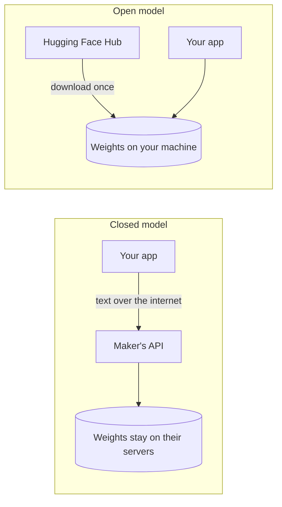
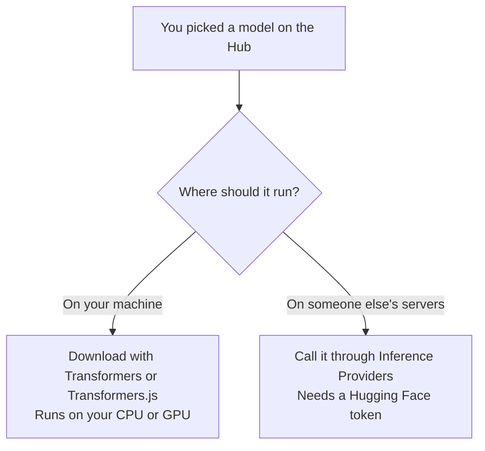

Hugging Face is the company behind the Hugging Face Hub, a website where people and companies share open AI models, datasets and demo apps. Think of it as GitHub for AI: each model lives in a Git repository you can browse, download and run on your own machine. Hugging Face also makes the libraries most developers use to run those models, such as Transformers for Python and Transformers.js for JavaScript.

If you have only used AI through ChatGPT or Claude, Hugging Face is where you go when you want a model you can hold in your own hands. By the end of this post, you'll run one in Node.

## What is the difference between an open model and a closed model?

An AI model is, in the end, a set of files: numbers learned during training (called **weights**) plus some config. The question is whether you can get those files.

- **Closed models**, like Claude and the models behind ChatGPT, stay on their maker's servers. You send text to an API and get text back. You never see the weights. If you're new to these models, start with [What is an LLM?](/blog/what-is-an-llm).
- **Open models** (often called **open-weight** models) publish their weight files. You can download them and run them on your laptop, your server, or a cloud GPU you rent.



Neither is better in every case. Closed models are usually the most capable and need no hardware. Open models give you control: your data stays on your machine, there is no per-token bill, and the model doesn't change unless you change it. Some companies publish both kinds. OpenAI, for example, publishes [gpt-oss-120b](https://huggingface.co/openai/gpt-oss-120b) on the Hub under the Apache 2.0 licence.

## What does the Hugging Face Hub host?

The Hub hosts three main kinds of Git repositories. According to the [Hub docs](https://huggingface.co/docs/hub/index), it holds over 2 million models, 1.5 million datasets and 1.5 million Spaces.

| Repo type | What it is | Example use |
| --- | --- | --- |
| Models | Weight files, config and a model card | Download a sentiment model and run it in your app |
| Datasets | Data for training and testing models | Test a model on real reviews before you ship it |
| Spaces | Small web apps that demo a model | Try a model in your browser before you install anything |

Because every repo is Git-based, you get versions, commit history and branches, just like code. Model repos also show which tasks a model does (for example "text classification" or "text generation"), which libraries can load it, and its licence.

**Spaces** are handy for a first look. Someone builds a small web page around a model, and you try it without writing code. The [Spaces docs](https://huggingface.co/docs/hub/spaces-overview) note that Spaces on free hardware go to sleep when nobody uses them, so the first visit can be slow.

## What is a model card, and why should I read it?

A model card is the `README.md` file of a model repo. The [model card docs](https://huggingface.co/docs/hub/model-cards) say it should describe the model, its intended uses and limitations (including biases), how it was trained, which data it used, and how well it scored in tests. A small block of metadata at the top lists things like the licence, the language and the datasets.

Read three things before you use a model:

1. **What it was made for.** A sentiment model trained on movie reviews may do poorly on support tickets. The card tells you what data it saw and which languages it knows.
2. **Its limitations.** For example, the card for the [DistilBERT SST-2 sentiment model](https://huggingface.co/distilbert/distilbert-base-uncased-finetuned-sst-2-english) (the one you'll run below) says it is English only and warns that it can give biased results for sentences that mention different countries.
3. **Its licence.** This is the one that can get you in trouble.


<Callout type="warning" title="Open does not mean free to use for anything">

Every model has its own licence. The [Hub's licence list](https://huggingface.co/docs/hub/repositories-licenses) includes permissive ones like `apache-2.0` and `mit`, non-commercial ones like `cc-by-nc-4.0`, and model-specific ones like the Llama and Gemma licences, which add their own rules. If a model is a converted or fine-tuned copy of another model, check the original model's licence too. Read the licence before you put a model in a product.

</Callout>


Some models are also **gated**. You have to log in, agree to the author's conditions and share your username and email before you can download the files. Depending on the author's settings, access is granted right away or after a manual review ([gated models docs](https://huggingface.co/docs/hub/models-gated)). To download a gated model from a script, you also need an access token.

## Which libraries do I use to run a model?

Hugging Face maintains two libraries you'll meet most often. Both have a `pipeline` function: you name a task and a model, and it handles downloading, preparing the input and reading the output.

| | Transformers | Transformers.js |
| --- | --- | --- |
| Language | Python | JavaScript, in the browser and Node |
| Install from | PyPI, with PyTorch | npm |
| Runs models with | PyTorch | ONNX Runtime |
| Good for | Running and training models | Running models in a JS app |

[Transformers](https://huggingface.co/docs/transformers/index) is the main library. It can run and train models, and its docs say it supports over 1 million model checkpoints on the Hub. In Python, the whole thing looks like this:

```py
from transformers import pipeline

classify = pipeline(
    "sentiment-analysis",
    model="distilbert/distilbert-base-uncased-finetuned-sst-2-english",
)

print(classify("The new release fixed my build. Great work!"))
```

[Transformers.js](https://huggingface.co/docs/transformers.js/index) is built to work like the Python library, with a very similar API, but in JavaScript. It needs models in the ONNX format, a common file format for models. Many popular models already have an ONNX copy on the Hub, and you can filter the Hub by the `transformers.js` library to find them.

## Should I run a model locally or call an API?

You have two ways to use a model from the Hub.



- **Locally.** The library downloads the model once and keeps a copy on disk. After that, your text never leaves your machine, and you pay nothing per request. You need enough memory and, for big models, a GPU.
- **Through an API.** [Inference Providers](https://huggingface.co/docs/inference-providers/index) lets you call hundreds of models hosted by partner companies, such as Groq, Together and Replicate, with one Hugging Face token. It works through the `@huggingface/inference` JavaScript client, the Python client, or an OpenAI-compatible endpoint. The [pricing page](https://huggingface.co/docs/inference-providers/pricing) lists small monthly free credits and pay-as-you-go pricing after that, with no markup on the providers' rates.

A simple rule: small models, private data or offline work point to local. Big models you can't fit on your hardware point to an API.

## How do I pick a model?

The Hub has millions of models, so filter hard. Go through these in order:

1. **Task.** Filter by what you need: text classification, translation, speech recognition, text generation. A model made for your task beats a bigger general one you have to coax.
2. **Size.** Smaller models download faster, use less memory and answer faster. Start with the smallest model that does the job, and only go bigger if the results aren't good enough.
3. **Licence.** Filter out anything you can't use for your purpose before you get attached to it.
4. **Where it will run.** For Transformers.js you need ONNX files. For Python, check that the card shows the `transformers` library.
5. **Signals.** Downloads and likes show that people use a model, not that it's good for you. The [download stats docs](https://huggingface.co/docs/hub/models-download-stats) explain that every request for certain files counts as a download, including requests from automated scripts. Treat these numbers as hints.

Then test the model on 20 or 30 examples from your real data. That tells you more than any number on the page.

## Try it: run a model from the Hub in Node

You'll run a small sentiment model on your own machine. Sentiment analysis means deciding whether a text sounds positive or negative. The model is [Xenova/distilbert-base-uncased-finetuned-sst-2-english](https://huggingface.co/Xenova/distilbert-base-uncased-finetuned-sst-2-english), an ONNX copy of the DistilBERT SST-2 model made for Transformers.js. The original model's licence is Apache 2.0. There is no API key and no account.

**You need:** [Node.js](https://nodejs.org) 20 or later (we used Node 22), a terminal in an empty folder, and about 70 MB of disk space for the model.


<Steps>


<Step title="Install Transformers.js">


```bash
npm install @huggingface/transformers
```


On Linux x64, the install also tries to download optional GPU (CUDA) files for ONNX Runtime, the engine that runs the model. If that step fails behind a strict firewall, skip it. The CPU version is already included:

```bash
$ ONNXRUNTIME_NODE_INSTALL=skip npm install @huggingface/transformers
```

</Step>


<Step title="Create the script">


**sentiment.mjs**

```js
import { pipeline } from '@huggingface/transformers';

// Downloads the model from the Hub on the first run, then reuses the local copy.
const classify = await pipeline(
  'sentiment-analysis',
  'Xenova/distilbert-base-uncased-finetuned-sst-2-english',
  { dtype: 'q8' },
);

const reviews = [
  'The new release fixed my build. Great work!',
  'The docs are outdated and the install keeps failing.',
  'The meeting is at 3 pm.',
];

for (const text of reviews) {
  const [result] = await classify(text);
  console.log(`${result.label} (${result.score.toFixed(4)})  ${text}`);
}
```


- `pipeline` takes a task name and a model ID from the Hub. The ID is the part of the model's URL after `huggingface.co/`.
- `dtype: 'q8'` asks for the quantized version: the same model stored with smaller numbers, so the file is about 4 times smaller.
- `result.score` is how sure the model is, from 0 to 1.

</Step>


<Step title="Run it">

```bash
$ node sentiment.mjs
```

The first run downloads the model files from the Hub, which takes a few seconds. You should see:

```text
POSITIVE (0.9998)  The new release fixed my build. Great work!
NEGATIVE (0.9998)  The docs are outdated and the install keeps failing.
POSITIVE (0.9330)  The meeting is at 3 pm.
```

</Step>


<Step title="Run it again">

Run the same command again. This time there is no download. Transformers.js saved the model in a `.cache` folder inside its package in `node_modules`, as the [Node.js tutorial](https://huggingface.co/docs/transformers.js/tutorials/node) describes. From now on, the model runs fully on your machine.

</Step>


</Steps>


Look at the third line. "The meeting is at 3 pm." is neither happy nor sad, but the model still says POSITIVE with 93% confidence. It only knows two labels, so it must pick one. This is exactly the kind of limit a model card warns you about, and why you test a model on your own data before you trust it.

## What should I do next?

- **Browse the Hub by task.** Open [huggingface.co/models](https://huggingface.co/models), pick a task in the left sidebar, and open a few model cards. Check the licence and the limitations of each one.
- **Swap the model.** Change the model ID in `sentiment.mjs` to another text-classification model that has ONNX files, and compare the results on your own sentences.
- **Run bigger models locally.** [How to run AI models locally](/blog/run-ai-models-locally) runs chat models on your own machine with tools built for that job.
