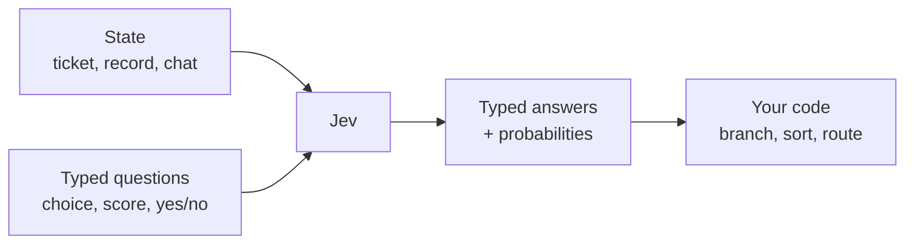

Jev is a model from TypeSafe AI that makes decisions instead of writing text. You give it some state, such as a support ticket or a JSON record, plus a few typed questions. It returns typed answers with probabilities: which option fits, where something sits on a scale, or how likely a statement is to be true. Your code can branch on those answers directly, with no text to parse.

If you know how an [LLM](/blog/what-is-an-llm) works, the short version is this: an LLM writes the next token again and again; Jev fills in answers to questions whose possible answers you defined in advance.

## Where does Jev come from?

TypeSafe AI [announced Jev on September 15, 2026](https://typesafe.ai/blog/introducing-system-one-models-and-jev), in early access. It is the company's first model and the first of what it calls **System One models**. A day later, Vercel [added it to AI Gateway](https://vercel.com/changelog/typesafe-ai-jev-now-available-on-ai-gateway) under the model ID `typesafe-ai/jev`.

TypeSafe describes Jev as "a frontier-intelligence function call: unstructured state in, typed probabilistic decisions out". That's a good mental model. You call it like a function. The arguments are some text or data and a list of questions. The return value is a typed object.



Two words matter here:

- **State** is the thing you want judged. It can be a string, a JSON object or an array of text. Jev reads text only, so images, audio and video are not supported.
- **Questions** are what you want to know about the state. Each has a type, an instruction in plain English and, for most types, the allowed answers.

## What does "System One" mean?

The name comes from Daniel Kahneman's book *Thinking, Fast and Slow*. In that book, "System 1" is fast, intuitive thinking, like recognizing a friend's face. "System 2" is slow, careful reasoning, like doing long division in your head.

TypeSafe uses the name for models built for the fast kind: quick, focused judgments that a knowledgeable person could make in a few seconds. Its docs say each question should be a "gut-check determination". If a decision needs long reasoning, you split it into smaller questions and combine the answers in your code.

So "System One" is a label for the kind of task Jev is built for. It doesn't mean Jev thinks like a person, and it doesn't mean it is always right. TypeSafe's own docs say its probabilities are calibrated across many predictions, but that calibration "does not guarantee that an individual answer is correct".

## What are the three answer types?

Jev answers three kinds of questions. TypeSafe calls them **primitives**, meaning basic building blocks you combine in code.

| Type | You define | You get back |
| --- | --- | --- |
| Choice: which option? | Named options with descriptions | The chosen option, a probability per option, a confidence |
| Score: where on a scale? | Ordered levels, lowest first | A number on the scale, a probability per level, a confidence |
| Yes/no: is it true? | Optionally, what counts as yes and no | The probability of "yes", from 0 to 1 |

The yes/no type has two names. TypeSafe's own API and Cloudflare call it `noul`. Vercel's AI SDK and AI Gateway call it `boolean`. It's the same idea: a single number, where 0 means no and 1 means yes.

The examples below use Vercel's shapes, from the [AI Gateway evaluation docs](https://vercel.com/docs/ai-gateway/modalities/evaluation). The outputs are copied from those docs, not from a run of ours.

### Choice: pick one option

State: "My card was charged twice for one order." Question: which team handles it, `billing`, `shipping` or `technical`?

```json
{
  "route": {
    "type": "choice",
    "choice": "billing",
    "probabilities": { "billing": 1, "shipping": 0, "technical": 0 }
  }
}
```

### Score: rate on a scale

State: "The PR adds tests, updates docs, and has a clear description." Question: rate its quality on four levels, from `poor` (0) to `excellent` (3).

```json
{
  "quality": {
    "type": "score",
    "score": 2.97,
    "probabilities": { "0": 0, "1": 0, "2": 0.02, "3": 0.98 }
  }
}
```

The score is an interpolated position on your scale, so 2.97 means "almost certainly level 3".

### Yes/no: how likely is it true?

State: "The build failed with exit code 1." Question: did the build succeed?

```json
{
  "passed": { "type": "boolean", "probability": 0.01 }
}
```

### What is confidence?

Choice and Score answers also carry a **confidence** from 0 to 1. TypeSafe computes it from the spread of the probabilities. All the probability on one option gives 1; an even split across options gives 0. Yes/no answers don't have one, because the probability already says how sure the model is.

On TypeSafe's API, `confidence` sits on each answer. Through the AI SDK, Vercel's [Jev guide](https://vercel.com/kb/guide/typesafe-jev-and-ai-sdk) says it is in the result's `providerMetadata`, under `typesafe.confidence`, keyed by question.

Confidence is what makes Jev useful for automation. Your code can act on its own when confidence is high and send the case to a person when it is low.

## How is Jev different from an LLM?

The next part of this series, [Jev vs LLMs](/blog/jev-vs-llms), compares them in depth. Here is the short version.

| | LLM | Jev |
| --- | --- | --- |
| Output | Free text, one token at a time | Only the typed answers you defined |
| Your code must | Parse and validate the text | Read fields from an object |
| Can it write replies or code? | Yes | No |
| Several questions | Usually one long answer, or several calls | Many questions in one call, answered in parallel |
| How sure is it? | Only if you ask, and self-reported | A probability on every answer |

TypeSafe's launch post says Jev "can't hallucinate". Read that narrowly. Jev can't return an option you didn't define or a value of the wrong type, because the answer space is fixed. It can still pick the wrong option. That's why the probabilities and confidence matter.

## Is Jev open source?

No. Jev is a proprietary model that you call over an API. As of September 2026:

- TypeSafe's [docs](https://docs.typesafe.ai/models) offer Jev only as a hosted service at `POST /v1/systemone`, and none of its official pages link to downloadable weights.
- TypeSafe's [Master Customer Agreement](https://typesafe.ai/legal/mca) says TypeSafe keeps all rights in the service, and forbids reverse engineering it or using its output to train a model that imitates it.
- Hugging Face has community models with "Jev" in their names. They come from other people, not TypeSafe, so don't treat them as the real thing.

If you need a model you can download and run on your own machine, Jev isn't it today. See [Run AI models locally](/blog/run-ai-models-locally) for options that are.

## Where can I use Jev?

You can call Jev in three places. All of them are hosted APIs.

| Where | Model ID | How you call it |
| --- | --- | --- |
| [TypeSafe](https://docs.typesafe.ai/introduction/quickstart) | `jev-latest` (currently `jev-1.13.0`) | HTTP API, Python and JavaScript SDKs, a web Playground. Early access. |
| [Vercel AI Gateway](https://vercel.com/ai-gateway/models/jev) | `typesafe-ai/jev` | AI SDK 7.0.105 or later (`experimental_evaluate`), or `POST /v1/evaluate` |
| [Cloudflare Workers AI](https://developers.cloudflare.com/ai/models/typesafe/jev/) | `typesafe/jev` | `env.AI.run()` in a Worker, or Cloudflare's REST API |

On AI Gateway, Jev doesn't work through the OpenAI-compatible or Anthropic-compatible endpoints, because it isn't a chat model. Use the AI SDK's `evaluate` function or the evaluation HTTP endpoint.

Vercel's [Jev page](https://vercel.com/kb/jev-from-typesafe-ai) also lists integrations for LangChain and TanStack AI.

## How much does Jev cost?

All three places list the same price, checked on September 28, 2026:

- **Input:** $0.042 per million tokens.
- **Output:** free.

AI Gateway [adds no markup](https://vercel.com/docs/ai-gateway/pricing) on tokens. For scale: the example response in Vercel's docs used 275 input tokens and cost $0.00001155. A thousand calls that size cost about one cent.

Two limits to know. First, when we checked, Jev was not in AI Gateway's free-tier model list, so you need purchased AI Gateway Credits to call it there. Second, a request can hold up to 64,000 tokens in total, and the state plus the longest question must fit in 32,000. Vercel's model page shows this as a 32K context window.

## How fast and cheap is it really?

You will see numbers like "193x faster and 445x cheaper than LLMs" in launch coverage. They come from [TypeSafe's own launch post](https://typesafe.ai/blog/introducing-system-one-models-and-jev), which says that on its workflow evaluations Jev was up to 193.6 times faster and 444.6 times cheaper. TypeSafe also claims response times of 70 to 500 milliseconds.

These are vendor claims, and TypeSafe is open about their limits. Its post says the workflows were built by its own team, "so some bias could exist". The results are "on the higher end of real world gains". And the reference answers came from other companies' large models, not from human labels.


<Callout type="warning" title="Test Jev on your own data">

Treat the speed and cost multipliers as TypeSafe's benchmarks, not facts about your workload. Before you let Jev make a real decision, run it on a sample of your own cases where you know the right answer, and decide which confidence level is high enough to act without a person. Our post on [testing AI output with evals](/blog/test-ai-output-with-evals) shows how.

</Callout>


## Try it: ask Jev three questions at once

This script sends one support ticket to Jev on AI Gateway and asks all three question types in one call. It follows the examples in [Vercel's evaluation docs](https://vercel.com/docs/ai-gateway/modalities/evaluation).

**You need:** Node.js 22, a Vercel account with purchased AI Gateway Credits, and an [AI Gateway API key](https://vercel.com/docs/ai-gateway/authentication-and-byok/api-keys).


<Steps>


<Step title="Install the AI SDK">

In an empty folder:


```bash
npm install ai
```


`experimental_evaluate` needs `ai` 7.0.105 or later.

</Step>


<Step title="Set your API key">

```bash
$ export AI_GATEWAY_API_KEY="your-key-here"
```

The AI SDK reads the key from this variable. Don't paste it into your code.

</Step>


<Step title="Write the script">


**jev.mjs**

```js
import { experimental_evaluate as evaluate } from 'ai';

const result = await evaluate({
  model: 'typesafe-ai/jev',
  state: 'My card was charged twice for one order. Please fix this today.',
  questions: {
    team: {
      type: 'choice',
      instructions: 'Which team should handle this ticket?',
      criteria: {
        billing: 'payment or charge problems',
        shipping: 'delivery problems',
        technical: 'application bugs',
      },
    },
    urgency: {
      type: 'score',
      instructions: 'How urgent is this ticket?',
      criteria: ['low', 'medium', 'high'],
    },
    wantsRefund: {
      type: 'boolean',
      instructions: 'Is the customer asking for money back?',
    },
  },
});

console.log(JSON.stringify(result.answers, null, 2));
```


Each key in `questions` (`team`, `urgency`, `wantsRefund`) comes back as a key in `result.answers`.

</Step>


<Step title="Run it">

```bash
$ node jev.mjs
```

You get one object with three answers: a `choice` for `team`, a `score` for `urgency` and a `probability` for `wantsRefund`, shaped like the examples above. Try changing the ticket text and watch the probabilities move.

</Step>


</Steps>


The fourth part of this series, [Build your first Jev app](/blog/build-your-first-jev-app), turns this into a small app that acts on the answers.

## What should I do next?

- **Read the rest of this series.** [Jev vs LLMs](/blog/jev-vs-llms) compares the two in detail. [When to use Jev](/blog/when-to-use-jev) helps you spot the decisions in your code that fit it. [Build your first Jev app](/blog/build-your-first-jev-app) builds something real. [How to test Jev on Vercel AI Gateway](/blog/test-jev-on-vercel-ai-gateway) covers API keys, credits and budgets so you can try it safely.
- **Skim TypeSafe's [introduction](https://docs.typesafe.ai/introduction)** for the full question options, such as criteria and structured state.
- **Brush up on the basics** with [What is an LLM?](/blog/what-is-an-llm) and [What is tool calling?](/blog/what-is-tool-calling). Jev often sits next to an LLM, not in its place.
