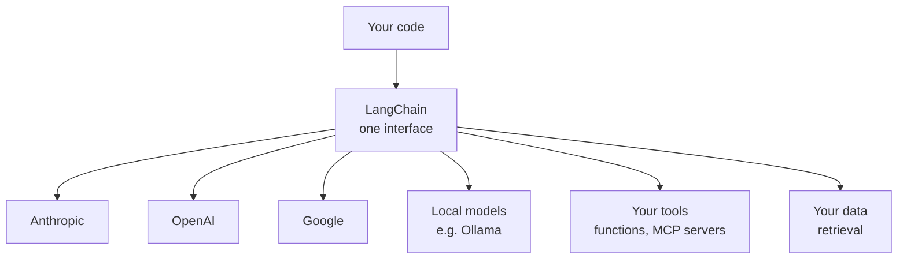
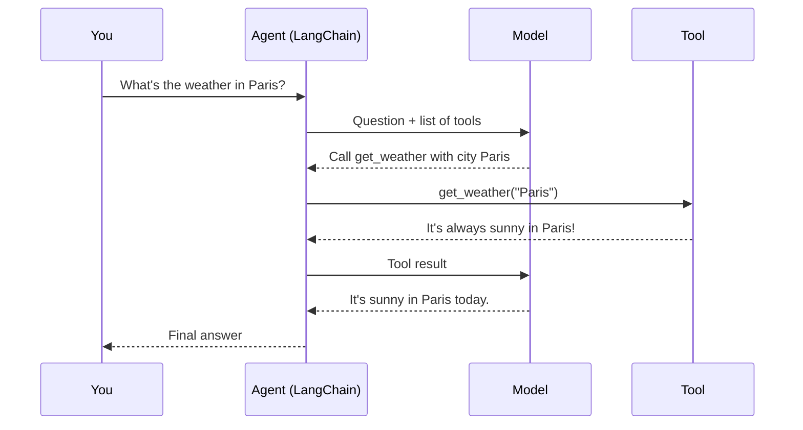

LangChain is an open-source framework for building apps and agents on top of large language models. It gives you one way to talk to many model providers, such as Anthropic, OpenAI and Google, plus ready-made pieces for tools, agents and retrieval. It exists for Python and JavaScript, and you can switch the model behind your app by changing one line.

If you are new to AI and keep seeing LangChain in tutorials and job posts, this post explains what it is, what its pieces do, and when you should (and shouldn't) use it. At the end you'll run a small LangChain agent on your own machine, with no API key.

## What problem does LangChain solve?

A large language model (LLM) turns text into more text. If that is new to you, start with [What is an LLM?](/blog/what-is-an-llm). To build something useful, you usually need more than one model call:

- **Talk to a model.** Every provider has its own API, its own message format and its own settings.
- **Give it tools.** A tool is a function the model can ask your code to run, such as "search the docs" or "get the weather".
- **Run a loop.** An agent is a model that calls tools, reads the results and decides the next step, again and again, until the task is done.
- **Bring in your data.** Retrieval finds the pieces of your documents that answer a question and puts them in the prompt. This is called RAG (retrieval-augmented generation).

You can write all of that yourself. LangChain's [philosophy page](https://docs.langchain.com/oss/javascript/langchain/philosophy) says its first goal is to standardize model inputs and outputs, because "different providers expose different APIs, with different model parameters and different message formats". Its second goal is to make it easy for models to use tools and data.



In short: you write your app against LangChain, and LangChain translates to each provider. The [install docs](https://docs.langchain.com/oss/javascript/langchain/install) say it has integrations for "hundreds of LLMs and thousands of other integrations", each in its own package. Its agents can also use tools from [MCP servers](https://docs.langchain.com/oss/javascript/langchain/mcp); see [What is MCP?](/blog/what-is-mcp) if that term is new.

## What are LangChain, LangGraph and LangSmith?

"LangChain" is the name of a company, a library and a family of products, which confuses many people. The [LangGraph overview](https://docs.langchain.com/oss/javascript/langgraph/overview) describes how they fit together. Here is each one in a line:

| Name | What it is | Open source? |
| --- | --- | --- |
| LangChain | The agent framework: a standard interface for models and tools, and `create_agent`, a ready-made agent loop | Yes (MIT) |
| LangGraph | The lower-level engine that LangChain agents run on. Use it when you want to control every step of a workflow | Yes (MIT) |
| Deep Agents | A higher-level, "batteries-included" agent built on LangChain, with planning, a virtual file system and sub-agents | Yes |
| LangSmith | A hosted platform to trace, debug and evaluate your agents. It works with LangChain and with other frameworks | No, closed source |

The [LangChain overview](https://docs.langchain.com/oss/javascript/langchain/overview) adds that LangChain's agents are built on top of LangGraph, which gives them features like persistence (saving the agent's progress) and human-in-the-loop (pausing so a person can approve a step).

As a beginner, you only need the first one. Reach for LangGraph when the ready-made agent gets in your way, and for LangSmith when you need to see what your agent actually did.


<Callout type="note" title="Old tutorials use a different API">

LangChain was [first released in October 2022](https://docs.langchain.com/oss/javascript/langchain/philosophy), and it changed a lot. Version 1.0, released on 20 October 2025, replaced the old "chains" and agent classes with a single agent built on LangGraph. If a tutorial uses legacy chains such as `LLMChain`, or builds agents with `create_react_agent`, it was written for the old API. Legacy chains now live in a separate package, `langchain-classic` in Python and `@langchain/classic` in JavaScript ([migration guide](https://docs.langchain.com/oss/python/migrate/langchain-v1)). For new code, use `create_agent`.

</Callout>


## How does a LangChain agent work?

The overview sums it up as **"Agent = Model + Harness"**. The model is the LLM. The harness is everything around it: the prompt, the tools, and the loop that runs them. In JavaScript you build one with `createAgent`; in Python it is `create_agent`.



The model never runs the tool itself. It only asks for it. LangChain runs your function, sends the result back to the model, and repeats until the model gives a final answer. This is the same agent loop described in the [AI roadmap for developers](/blog/ai-roadmap-for-developers); LangChain writes that loop for you.

To use a different provider, you change the `model` value. The [agent docs](https://docs.langchain.com/oss/javascript/langchain/agents) accept a `"provider:model"` string, such as `"anthropic:claude-sonnet-5"`, or a model object you created yourself.

## Is LangChain for Python or JavaScript?

Both. They are separate libraries with the same ideas. LangChain [started in Python](https://docs.langchain.com/oss/javascript/langchain/philosophy), and the JavaScript version followed in January 2023.

| | Python | JavaScript / TypeScript |
| --- | --- | --- |
| Repo | [langchain-ai/langchain](https://github.com/langchain-ai/langchain) | [langchain-ai/langchainjs](https://github.com/langchain-ai/langchainjs) |
| Install | `pip install -U langchain` | `npm install langchain @langchain/core` |
| Needs | Python 3.10+ | Node.js 22+ |
| Build an agent | `create_agent` from `langchain.agents` | `createAgent` from `langchain` |
| Provider packages | `langchain-anthropic`, `langchain-openai`, … | `@langchain/anthropic`, `@langchain/openai`, … |

The install commands and version requirements come from the [Python](https://docs.langchain.com/oss/python/langchain/install) and [JavaScript](https://docs.langchain.com/oss/javascript/langchain/install) install pages. Pick the one that matches the rest of your app. This post uses JavaScript.

## Should I use a framework or call the model API directly?

It depends on what you are building. Anthropic's guide [Building effective agents](https://www.anthropic.com/engineering/building-effective-agents) gives balanced advice. Frameworks "make it easy to get started by simplifying standard low-level tasks like calling LLMs, defining and parsing tools, and chaining calls together". But they "often create extra layers of abstraction that can obscure the underlying prompts and responses, making them harder to debug".

Its suggestion: start with the model API directly, because "many patterns can be implemented in a few lines of code". If you do use a framework, "ensure you understand the underlying code".

Here is how that plays out in practice:

| Your situation | A good starting point |
| --- | --- |
| One model call: summarize, classify, translate | The provider's API or SDK directly |
| You're learning how tools and agents work | The API directly, so you see every request |
| You want to switch between providers, or test several | LangChain's standard model interface |
| An agent with many tools, memory or human approval steps | LangChain's `create_agent`, or LangGraph for full control |
| You need to trace and evaluate an agent in production | LangSmith, or another tracing tool |

The trade-off in one line: a framework saves you glue code, and in return you learn its concepts and debug through its layers. Neither choice is wrong. Write one small agent loop by hand first, and you'll know what any framework is doing for you.

## Are there alternatives to LangChain?

Yes. The same Anthropic guide lists other frameworks for building agents: the [Claude Agent SDK](https://code.claude.com/docs/en/agent-sdk/overview), the Strands Agents SDK by AWS, and Rivet and Vellum, which are visual tools for building workflows. Model providers also offer their own [client SDKs](https://platform.claude.com/docs/en/cli-sdks-libraries/overview), which is the "call the API directly" option. Compare a few on the job you actually have before you commit.

## Try it: run a LangChain agent with no API key

You'll build the weather agent from the diagram above. Instead of a real model, you'll use `fakeModel`, a fake chat model that LangChain ships for [unit tests](https://docs.langchain.com/oss/javascript/langchain/test/unit-testing). You script its replies in advance, so it needs no API key, no account and no network. Everything else, the agent, the tool and the loop, is real LangChain code.

**You need:** [Node.js](https://nodejs.org) 22 or later and a terminal in an empty folder.


<Steps>


<Step title="Install the packages">


```bash
npm install langchain @langchain/core zod
```


- `langchain` has `createAgent`, `tool` and `fakeModel`.
- `@langchain/core` has the message types, such as `AIMessage`.
- `zod` describes the input your tool expects, so the model knows what to send.

</Step>


<Step title="Create the agent">


**agent.mjs**

```js
import { createAgent, fakeModel, tool } from "langchain";
import { AIMessage } from "@langchain/core/messages";
import * as z from "zod";

// A tool: a normal function that the model can ask to run.
const getWeather = tool(
  (input) => `It's always sunny in ${input.city}!`,
  {
    name: "get_weather",
    description: "Get the weather for a given city",
    schema: z.object({
      city: z.string().describe("The city to get the weather for"),
    }),
  }
);

// A fake model with two scripted replies. No API key, no network.
const model = fakeModel()
  .respond(
    new AIMessage({
      content: "",
      tool_calls: [
        { name: "get_weather", args: { city: "Paris" }, id: "call_1", type: "tool_call" },
      ],
    })
  )
  .respond(new AIMessage("It's sunny in Paris today."));

const agent = createAgent({ model, tools: [getWeather] });

const result = await agent.invoke({
  messages: [{ role: "user", content: "What's the weather in Paris?" }],
});

for (const message of result.messages) {
  const calls = message.tool_calls ?? [];
  const text = calls.length
    ? calls.map((c) => `call ${c.name}(${JSON.stringify(c.args)})`).join(", ")
    : message.text;
  console.log(`${message.type.padEnd(5)} | ${text}`);
}
console.log(`Model calls: ${model.callCount}`);
```


The fake model's first reply asks for the `get_weather` tool. Its second reply is the final answer. A real model would decide these replies itself.

</Step>


<Step title="Run it">

```bash
$ node agent.mjs
```

You should see:

```text
human | What's the weather in Paris?
ai    | call get_weather({"city":"Paris"})
tool  | It's always sunny in Paris!
ai    | It's sunny in Paris today.
Model calls: 2
```

Read it from top to bottom and you'll see the agent loop: your question, the model asking for a tool, LangChain running your function, and the model's final answer. The model was called twice, once per step.

</Step>


<Step title="Swap in a real model (needs an API key)">

To use Claude, install the Anthropic provider package:


```bash
npm install @langchain/anthropic
```


Then pass a real model instead of the fake one. The tool and the agent stay the same; this version prints only the final answer:


**claude.mjs**

```js
import { createAgent, tool } from "langchain";
import * as z from "zod";

const getWeather = tool(
  (input) => `It's always sunny in ${input.city}!`,
  {
    name: "get_weather",
    description: "Get the weather for a given city",
    schema: z.object({
      city: z.string().describe("The city to get the weather for"),
    }),
  }
);

// A real model instead of the fake one. Reads ANTHROPIC_API_KEY from the environment.
const agent = createAgent({
  model: "anthropic:claude-sonnet-5",
  tools: [getWeather],
});

const result = await agent.invoke({
  messages: [{ role: "user", content: "What's the weather in Paris?" }],
});

console.log(result.messages.at(-1).text);
```


Create an API key in the [Claude Console](https://platform.claude.com/), set it as the `ANTHROPIC_API_KEY` environment variable in your terminal, and run `node claude.mjs`. Real calls cost money per token, so check the [pricing page](https://platform.claude.com/docs/en/about-claude/pricing) first. Keep the key out of your code and out of git.

To try another provider, install its package and change the model string, for example `"openai:gpt-5.5"` with `@langchain/openai`.

</Step>


</Steps>


The fake model is also how you'd test a real agent: script the model's replies, then check that your tools and your code do the right thing, all without paying for tokens.

## What should I do next?

- **Write the loop by hand once.** Call a model API directly (see [Your first LLM API call](/blog/first-llm-api-call)), give it one tool, and run the loop yourself, as in [How to build your first AI agent in Node.js](/blog/build-your-first-ai-agent). Then compare it with the LangChain version above. The [AI roadmap for developers](/blog/ai-roadmap-for-developers) shows where this fits.
- **Follow the official quickstart** at [docs.langchain.com](https://docs.langchain.com/oss/javascript/langchain/quickstart) to add a detailed system prompt, memory and tests to your agent.
- **Connect a real tool.** Point your agent at an MCP server instead of a made-up weather function. Start with [What is MCP?](/blog/what-is-mcp)
