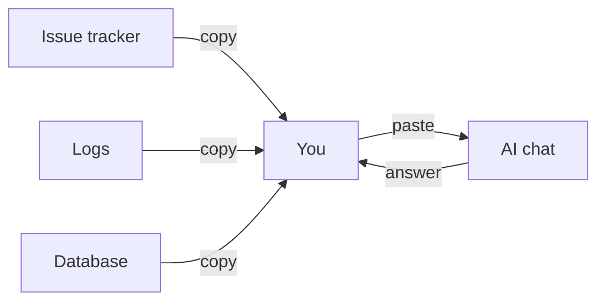
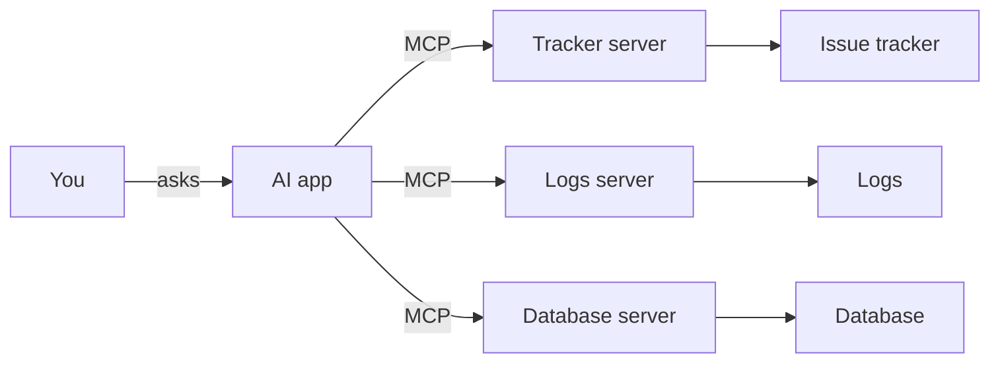
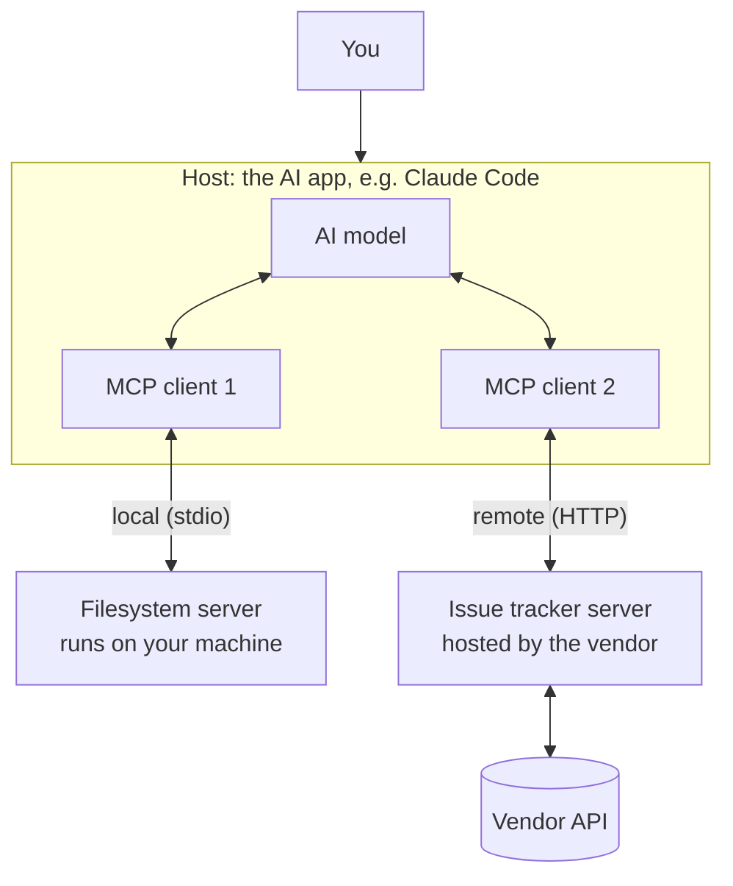
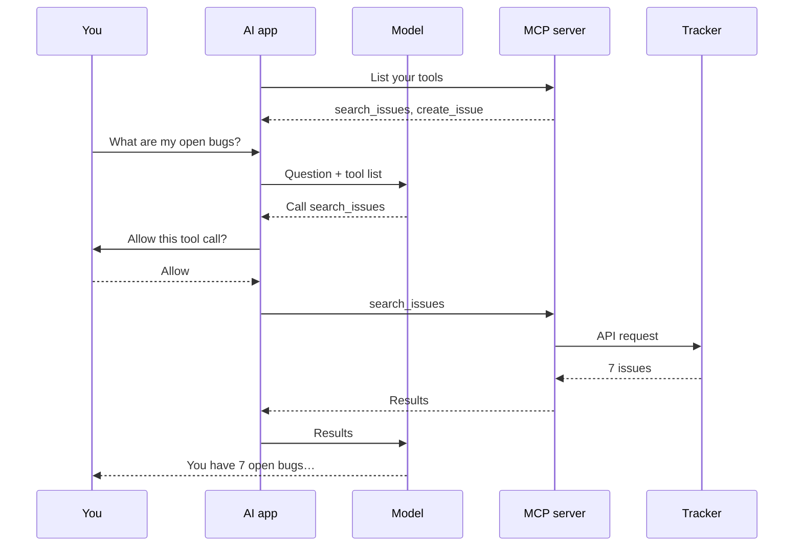

MCP (Model Context Protocol) is an open standard for connecting AI apps to outside tools and data. Instead of copying text between your issue tracker and a chat window, you connect the tracker once, and the AI can look things up and take actions itself. The [official docs](https://modelcontextprotocol.io/docs/getting-started/intro) compare it to a USB-C port for AI apps: one standard plug that works with many devices.

If you already use ChatGPT, Meta AI or Claude to answer questions and write code, MCP is the piece that lets those assistants work with your real systems instead of only what you paste in.

## What problem does MCP solve?

Out of the box, an AI assistant works with what it learned in training, what you type or upload, and, in some apps, the public web. Your own systems, such as your issue tracker, logs and database, stay out of reach. For those, you copy and paste.



You are the integration layer. That works for one question. It breaks down when the answer needs your latest issues, your database, or a page that changed yesterday.

Before MCP, each AI app had to build its own connector for each tool. Ten apps and twenty tools meant up to two hundred custom integrations. MCP replaces that with one protocol: a tool is wrapped once as an **MCP server**, and every app that speaks MCP can use it.



## How does MCP work?

MCP has three roles. The names sound abstract, but they map to things you already use.

| Role | What it is | Example |
| --- | --- | --- |
| Host | The AI app you talk to | Claude Code, Claude Desktop, VS Code |
| Client | A connector inside the host, one per server | Created for you when you add a server |
| Server | A program that exposes a tool or data source | A GitHub server, a Postgres server, a docs search server |



A server can run in two places:

- **Local servers** run as a program on your machine. The app starts them and talks to them over standard input and output (stdio). They are good for your files, a local database or a browser.
- **Remote servers** are hosted by a company at a URL and use HTTP. They are good for cloud services like Notion, Sentry or Linear, and often ask you to sign in.

Under the hood, messages are JSON-RPC 2.0. You don't need to know that to use MCP, but it is why any language can implement a server.

## What happens when you ask a question?

Here is one question, "What are my open bugs?", traveling through MCP:



Two details matter:

- **The model decides when to use a tool.** You ask in plain language; the model picks the tool and its arguments from the list the server published.
- **You stay in control.** Apps like Claude Code ask for your permission before a tool runs, until you choose to allow it.

## What can an MCP server offer?

Servers expose three kinds of things. These are the protocol's core building blocks, which the spec calls primitives.

| Primitive | What it is | Example |
| --- | --- | --- |
| Tools | Actions the AI can run | Search issues, run a SQL query, create a pull request |
| Resources | Data the AI can read | A file, a database schema, a record |
| Prompts | Reusable prompt templates | "Summarize this incident" with the right structure |

Most servers you meet will be mainly tools.

## Which apps support MCP?

Support is broad and growing, but it varies by app and plan:

- **Claude**: Claude Code, the Claude desktop app and claude.ai all connect to MCP servers.
- **ChatGPT**: supports MCP-powered apps. [Developer mode](https://developers.openai.com/api/docs/guides/developer-mode), which lets you connect your own MCP servers, is available on Pro, Plus, Business, Enterprise and Education plans on ChatGPT web.
- **Meta AI**: Meta says its [Muse Spark 1.1 model](https://ai.meta.com/blog/introducing-muse-spark-meta-model-api/) can work with MCP servers it hasn't seen before. Whether you can plug a server into the Meta AI app itself depends on the app, so check its settings.
- **Code editors**: VS Code and Cursor support MCP, among many others.

The rest of this post uses Claude Code, because adding a server there is a single command.

## Where do I find MCP servers?

You rarely need to build one. Start here:

1. **[The official MCP Registry](https://registry.modelcontextprotocol.io).** A central, searchable list of public servers, backed by Anthropic, GitHub, Microsoft and others. It is still in preview, so [expect some changes](https://modelcontextprotocol.io/registry/about).
2. **[The Anthropic Directory](https://claude.ai/directory).** Reviewed connectors for Claude. Any remote server listed there can be added to Claude Code with `claude mcp add`.
3. **[The modelcontextprotocol/servers repo](https://github.com/modelcontextprotocol/servers)** on GitHub. A small set of reference servers from the MCP maintainers, such as Filesystem, Git and Fetch. They are educational examples, not production-ready, so use them to learn and look to the Registry for servers to rely on.
4. **The docs of the tool you already use.** Many companies publish an official server. Search their docs for "MCP", for example Notion's `https://mcp.notion.com/mcp` or Sentry's `https://mcp.sentry.dev/mcp`.

Prefer official servers from the company that owns the system. They are maintained, and they handle sign-in properly.

## Try it: connect your first MCP server

You'll connect Claude Code to a hosted server that searches the Claude Code documentation. It needs no account or API key, so it's a safe first test.

**You need:** [Claude Code installed and signed in](https://code.claude.com/docs/en/setup), and a terminal open in any folder.


<Steps>


<Step title="Add the server">

Run this in your terminal, not inside a Claude session:

```bash
$ claude mcp add --transport http claude-code-docs https://code.claude.com/docs/mcp
```

- `--transport http` means the server is hosted at a URL.
- `claude-code-docs` is a name you choose. You'll see it in Claude's output.
- The last part is the server's URL.

</Step>


<Step title="Check the connection">

```bash
$ claude mcp list
```

You should see `claude-code-docs` with `✔ Connected`.

</Step>


<Step title="Use it">

Start a session and ask a question that needs the server:

```bash
$ claude
```

```text
Use the claude-code-docs server to look up what MCP_TIMEOUT does
```

Approve the tool call when asked. The call is labeled with the server's name, which is how you know the answer came from the server and not the model's memory.

</Step>


<Step title="Remove it when you're done (optional)">

```bash
$ claude mcp remove claude-code-docs
```

Every connected server takes a little room in the AI's context, so remove the ones you don't use.

</Step>


</Steps>


That's the whole loop: find a server, add it with its URL, check it, use it. Servers that need an account, like Notion or Sentry, add one step: a browser sign-in after `claude mcp add`.

## Is MCP safe to use?


<Callout type="warning" title="Only connect servers you trust">

A server can read and act on whatever it connects to. Servers that fetch outside content, such as web pages or issue comments, can also expose you to prompt injection: hidden instructions in that content that try to steer the AI. Keep tool-call approvals on until you know what a server does, and read the [MCP security best practices](https://modelcontextprotocol.io/docs/tutorials/security/security_best_practices).

</Callout>


Three habits cover most of the risk:

- Install servers from the company that owns the system, or from a source you've reviewed.
- Give servers the least access they need, such as a read-only database user.
- Don't paste API keys into chat. Pass them when you add the server, as its docs describe.

## What should I do next?

- **Add a server for a tool you use every day**, like your issue tracker or error monitoring, and ask it the questions you normally answer by copy-paste.
- **Try a local server.** The Playwright server gives Claude a real browser: `claude mcp add playwright -- npx -y @playwright/mcp@latest`. See the [Claude Code MCP quickstart](https://code.claude.com/docs/en/mcp-quickstart).
- **Read the architecture overview** at [modelcontextprotocol.io](https://modelcontextprotocol.io/docs/learn/architecture) when you want the details behind the diagrams above.
- **Build your own server** with [How to build your first MCP server in TypeScript](/blog/build-your-first-mcp-server).
