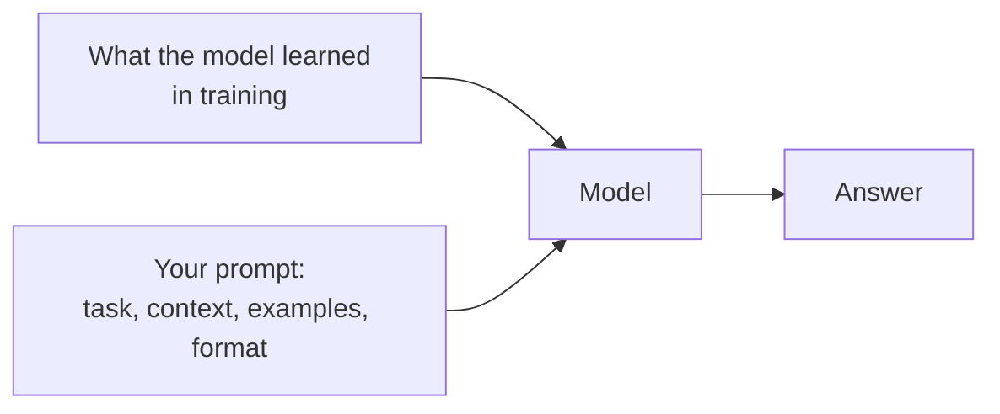
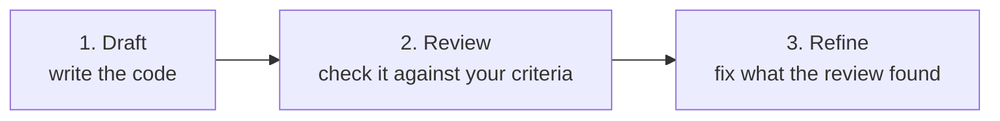
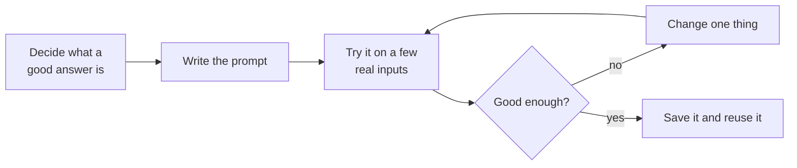

Prompt engineering is the skill of writing your request to an AI model so it gives you the answer you need on the first try. The model only knows what it learned in training and what you put in your message. So the words you choose, the context you add and the shape you ask for change the answer a lot.

If you already use ChatGPT or Claude to answer questions and write code, you already write prompts. This post explains why wording matters and the handful of techniques that fix most bad answers, based on [Anthropic's prompt engineering docs](https://platform.claude.com/docs/en/build-with-claude/prompt-engineering/overview).

## What is a prompt?

A prompt is everything you send to the model: your question, your instructions, and any code, logs or documents you paste in. In a chat app, it is the message you type (plus the conversation so far). In code, it is the text you send to the API.

Prompt engineering is the craft of structuring those instructions to get better results. Anthropic's [prompt engineering guide](https://claude.com/blog/best-practices-for-prompt-engineering) describes it as how you phrase requests, specify style, provide context and guide the model's behavior.

It is not magic words. Most of it is what a good bug report or a good ticket already does: say what you want, give the needed context, and say what "done" looks like.

## Why does the wording change the answer?

Because an LLM writes the most likely continuation of the text it is given. If you are new to that idea, read [What is an LLM?](/blog/what-is-an-llm) first. Everything in your prompt shapes what "most likely" means.



When your prompt is vague, the model fills the gaps with the most common guess. "Write a login function" could mean any language, any framework and any security level, so you get a generic answer. When your prompt says Node.js 22, Express, bcrypt and "return a 401 on failure", the likely answer is the one you wanted.

Anthropic's [best practices](https://platform.claude.com/docs/en/build-with-claude/prompt-engineering/claude-prompting-best-practices#be-clear-and-direct) put it well: think of the model as a brilliant but new employee who doesn't know your norms and workflows. Their golden rule is to show your prompt to a colleague with little context on the task. If they would be confused, the model will be too.

## What does a better prompt look like?

Here is a real developer task: a code review.

**Before:**

```text
Review my code.

[paste the function here]
```

The model doesn't know your language version, what the code is for, what you care about, or how you want the answer. You'll likely get a long, general list that mixes style tips with real bugs.

**After:**

```text
You are reviewing a pull request for a Node.js 22 API that handles payments.
I want to merge it today, so focus on bugs and security problems, not style.

<code>
[paste the function here]
</code>

For each problem, give:
1. The line
2. What goes wrong, in one sentence
3. A fixed version of that code

If you find no real problems, say so. If you need to see other files to be sure,
tell me which ones instead of guessing.
```

Each line in the second prompt does a job:

| Part of the prompt | Technique |
| --- | --- |
| "You are reviewing a pull request for a Node.js 22 API that handles payments." | Give a role and context |
| "I want to merge it today, so focus on bugs…" | Explain why, so the model knows what matters |
| `<code>` … `</code>` | Separate your data from your instructions |
| "For each problem, give: 1… 2… 3…" | Ask for a specific format |
| "If you find no real problems, say so…" | Allow "I don't know" instead of a guess |

Before you paste code or logs into any AI tool, remove API keys, passwords and customer data.

## What are the core techniques?

These come from Anthropic's [prompting best practices](https://platform.claude.com/docs/en/build-with-claude/prompt-engineering/claude-prompting-best-practices), the living reference for Claude, and they apply to most chat models.

| Technique | What you do | Example you can add |
| --- | --- | --- |
| Be clear and direct | Say exactly what you want, including format and limits | "Write a TypeScript function. No external libraries." |
| Give context and the why | Explain the goal, the audience, or why a rule exists | "This runs on every request, so keep it fast." |
| Show examples | Give one to a few examples of the output you want | "Here is a test name in our style: …" |
| Structure the prompt | Put each part in its own tag or section | `<logs>` … `</logs>`, `<instructions>` … `</instructions>` |
| Ask for a format | Describe the shape of the answer, and say what to do rather than what not to do | "Answer in one table with columns: file, problem, fix." |
| Let it think step by step | Ask the model to reason before it answers on hard problems | "Think through the possible causes first, then answer." |
| Set a role | Tell the model who it is and what it focuses on, often in a system prompt | "You are a senior Node.js reviewer." |
| Break big tasks into steps | Split one huge request into a chain of smaller prompts | Draft, then review the draft, then improve it |
| Allow "I don't know" | Give permission to say it lacks information | "If the logs don't show the cause, say so." |

The next sections explain each one in plain words.

### Be clear, direct and specific

State the task with an action verb ("Write", "Explain", "Find") and the details that matter: language, version, limits, length. If you want more than the minimum, [ask for it](https://platform.claude.com/docs/en/build-with-claude/prompt-engineering/claude-prompting-best-practices#be-clear-and-direct). When the order of steps matters, write them as a numbered list.

### Give context and the reason

A rule with a reason works better than a bare rule. The docs' example: instead of "NEVER use ellipses", say the answer will be read aloud by a text-to-speech engine, so it must not use ellipses. The model [generalizes from the explanation](https://platform.claude.com/docs/en/build-with-claude/prompt-engineering/claude-prompting-best-practices#add-context-to-improve-performance) to cases your rule didn't mention.

### Show examples

Examples are one of the most reliable ways to control format, tone and structure. This is called few-shot prompting ("shots" are examples). Anthropic's docs [suggest 3 to 5](https://platform.claude.com/docs/en/build-with-claude/prompt-engineering/claude-prompting-best-practices#use-examples-effectively) varied examples, wrapped in `<example>` tags. Their [prompting guide](https://claude.com/blog/best-practices-for-prompt-engineering) suggests starting with one and adding more only if the output still doesn't match. The model copies details closely, so make sure your examples show only what you want.

### Separate the parts with tags or headings

When a prompt mixes instructions, context and pasted data, wrap each in its own [XML-style tag](https://platform.claude.com/docs/en/build-with-claude/prompt-engineering/claude-prompting-best-practices#structure-prompts-with-xml-tags), such as `<instructions>`, `<context>` and `<logs>`. The tag names are yours to choose; they only mark where each part starts and ends. Clear Markdown headings work too, and [OpenAI's guide](https://developers.openai.com/api/docs/guides/prompt-engineering) recommends both Markdown and XML tags for the same reason.

### Ask for the format you want

Say what the answer should look like: a table, a JSON object, a single code block, three bullet points. The docs also advise telling the model [what to do instead of what not to do](https://platform.claude.com/docs/en/build-with-claude/prompt-engineering/claude-prompting-best-practices#control-the-format-of-responses): "Write in flowing paragraphs" works better than "Don't use Markdown". The style of your prompt can rub off too: to get less Markdown back, use less Markdown in your prompt.

### Let the model think step by step

For problems with several steps, like debugging, an answer is better when the model reasons first. Many newer models can already think before they answer; Anthropic calls this [adaptive thinking](https://platform.claude.com/docs/en/build-with-claude/prompt-engineering/claude-prompting-best-practices#leverage-thinking-and-interleaved-thinking-capabilities), and on some Claude models it is always on. When thinking is off or not available, asking the model to reason through the problem step by step still helps. You can also ask it to check its answer against your criteria before it finishes.

### Set a role with a system prompt

A **system prompt** is a set of instructions that applies to the whole conversation, like the model's job description. A [single sentence of role](https://platform.claude.com/docs/en/build-with-claude/prompt-engineering/claude-prompting-best-practices#give-claude-a-role) can focus the model's behavior and tone. Keep it simple: Anthropic's [guide](https://claude.com/blog/best-practices-for-prompt-engineering) warns that over-specific roles can make the model less helpful, and that saying which perspective you want is often enough.

In code, the system prompt is a separate field from the user's message. Here is a minimal call with the official [TypeScript SDK](https://platform.claude.com/docs/en/cli-sdks-libraries/sdks/typescript). It needs an Anthropic API key in the `ANTHROPIC_API_KEY` environment variable.


```bash
npm install @anthropic-ai/sdk
```


**ask.mjs**

```js
import Anthropic from '@anthropic-ai/sdk';

const client = new Anthropic(); // reads ANTHROPIC_API_KEY from the environment

const message = await client.messages.create({
  model: 'claude-opus-5-5',
  max_tokens: 1024,
  system: 'You are a senior JavaScript developer. Answer with short, working code examples.',
  messages: [
    { role: 'user', content: 'How do I sort an array of objects by a date field?' },
  ],
});

for (const block of message.content) {
  if (block.type === 'text') console.log(block.text);
}
```


```bash
$ node ask.mjs
```

In a chat app, put the same role text at the top of your first message.

### Break big tasks into steps

One giant prompt that asks for a design, the code, the tests and the docs at once is hard to get right. Split it into a chain of smaller prompts, where each answer feeds the next. The most common chain in Anthropic's docs is [self-correction](https://platform.claude.com/docs/en/build-with-claude/prompt-engineering/claude-prompting-best-practices#chain-complex-prompts):



It takes more turns, but each step is easier, and you can check the result in between.

### Allow "I don't know"

Tell the model it may say it lacks the information. Anthropic's guide to [reducing hallucinations](https://platform.claude.com/docs/en/test-and-evaluate/strengthen-guardrails/reduce-hallucinations) says this simple permission can "drastically reduce false information". For long documents, you can also ask it to quote the exact lines it based its answer on, and to use only the text you gave it.


<Callout type="warning" title="Better prompts reduce mistakes, they don't remove them">

The same guide says these techniques don't eliminate hallucinations entirely. Always check critical information yourself: run the code, read the docs page, test the query.

</Callout>


## How do I know a prompt is better?

Treat a prompt like code: you test it. Anthropic's [overview](https://platform.claude.com/docs/en/build-with-claude/prompt-engineering/overview) says to start with three things: a clear definition of success, a way to test against it, and a first draft of the prompt.



For a chat prompt, "a few real inputs" can mean three different functions or three different error logs. Change one thing at a time, so you know which change helped.

The same overview notes that not every problem is a prompt problem. If an answer is too slow or too expensive, a different model may help more than a better prompt.

## Try it: improve one prompt you already use

You'll see the difference yourself, in any AI chat app, with no code and no API key.


<Steps>


<Step title="Pick a real task">

Choose something you asked an AI this week: explaining an error, writing a function, or summarizing a pull request.

</Step>


<Step title="Send the short version">

Open a new chat and send the prompt the way you usually would, for example:

```text
Explain this error.

[paste the error here]
```

Save the answer.

</Step>


<Step title="Send the improved version">

Open another new chat, so the first answer doesn't influence it. Add context, tags, a format and permission to say "I don't know":

```text
I'm a backend developer. This error appears when our Node.js 22 service starts.
I need to know what causes it and how to fix it.

<error>
[paste the error here]
</error>

Answer in this format:
1. What the error means, in one or two sentences
2. The most likely cause
3. How to fix it, with the exact command or code change

If the error doesn't show enough to know the cause, say so and tell me what
extra information you need.
```

</Step>


<Step title="Compare the two answers">

Which one could you act on right away? Note which change made the biggest difference. That is the habit to keep.

</Step>


</Steps>


## What should I do next?

- **Rewrite one prompt you use every day** with the table above, and save the good version where you can reuse it.
- **Read the source:** Anthropic's [prompting best practices](https://platform.claude.com/docs/en/build-with-claude/prompt-engineering/claude-prompting-best-practices) goes deeper, and its [interactive tutorial](https://github.com/anthropics/prompt-eng-interactive-tutorial) has exercises in nine chapters.
- **Next in this series:** [How to write your first effective prompt, step by step](/blog/write-your-first-prompt) takes one real task and improves its prompt one small change at a time.
- **See the bigger picture** in the [AI roadmap for developers](/blog/ai-roadmap-for-developers), where prompts are step 2 of 6.
