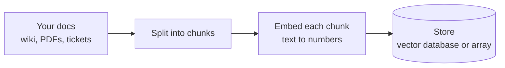
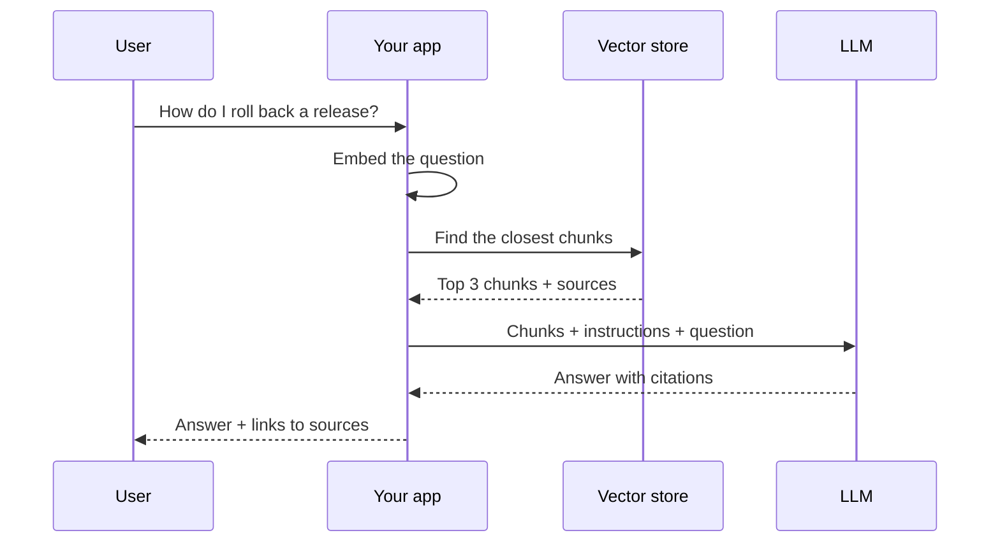

RAG (retrieval-augmented generation) is a way to make an AI model answer from your own data. Before the model answers, your app finds the few pieces of your documents that match the question and puts them into the prompt. The model then answers from those pieces, and it can tell you where each fact came from.

It is the idea behind most "chat with your docs" features. This post explains how it works, in plain words, and where it helps and where it doesn't.

## Why doesn't the model know my data?

A large language model (LLM) learns from a huge amount of text, up to a cutoff date. After that, it only knows what you put in the prompt. If you're new to this, [What is an LLM?](/blog/what-is-an-llm) explains it step by step.

So the model has two blind spots:

- **Your private data.** It never saw your wiki, your tickets or your runbooks.
- **Anything recent.** It doesn't know what changed after its training data ends.

The simple fix is to paste the right text into the prompt. That works for one question. But you can't paste your whole wiki into every request, and you don't know in advance which page a user will ask about. RAG automates the "find the right text and paste it" step.

## What is the idea behind RAG?

The name has three parts, and each one is a step:

1. **Retrieval.** Search your data for the pieces that match the question.
2. **Augmented.** Add those pieces to the prompt.
3. **Generation.** The model writes the answer, using those pieces.

Think of an open-book exam. The model is the student. RAG is the helper who finds the right three pages in the book and puts them on the desk before each question.

[Anthropic's glossary](https://platform.claude.com/docs/en/about-claude/glossary) describes RAG in the same way: relevant information is retrieved from a knowledge base at question time and "passed to the model along with the original query". The term comes from a [2020 research paper](https://arxiv.org/abs/2005.11401) by Patrick Lewis and others. They combined a model with a searchable index of Wikipedia, and found the answers were "more specific, diverse and factual" than from the model alone.

## How does RAG work?

RAG has two phases. The first one prepares your data. The second one runs for every question.

### Phase 1: Indexing (once, and again when your data changes)



- **Split into chunks.** A chunk is a small piece of a document, such as one section or a few paragraphs. You search small pieces so you can send only the relevant part, not a whole 40-page manual.
- **Embed each chunk.** An embedding model turns each chunk into a list of numbers, called a vector. Texts with similar meaning get similar numbers. So "reset my password" and "I can't log in" end up close together, even though they share no words.
- **Store the vectors.** Keep each vector next to its chunk text and its source, such as the file name. A vector database does this at scale. For a small project, an array in memory is enough.

### Phase 2: Answering (every question)



1. **Embed the question** with the same embedding model you used for the chunks.
2. **Search.** Find the chunks whose vectors are closest to the question's vector. You usually keep the top few, often called top-k (for example, the top 3).
3. **Build the prompt.** Put those chunks in the prompt, with instructions and the question.
4. **Generate.** The model answers from the chunks.

Notice that in this basic setup the model itself doesn't search. Your app does, before it calls the model, and the model only sees the result. The glossary notes that a model can also fetch the data itself if you give it a search tool, but you don't need that to start.

## What does a RAG prompt look like?

Here is a small example. The chunks go first, each with its source, then the instructions, then the question:

```text
<documents>
<document index="1">
<source>deploys.md > Rollbacks</source>
<document_content>
To roll back, run the "Rollback" job in CI and pick the last good release.
</document_content>
</document>
</documents>

Answer the question using only the documents above.
Cite the source of each fact in square brackets.
If the documents don't contain the answer, say "I don't know based on the notes."

Question: How do I roll back a release?
```

Each part has a job:

- **Sources** let the model cite them, so users can check the answer.
- **"Only the documents above"** keeps the model from mixing in guesses. Anthropic's guide to [reducing hallucinations](https://platform.claude.com/docs/en/test-and-evaluate/strengthen-guardrails/reduce-hallucinations) suggests exactly this, plus letting the model say "I don't know".
- **Documents first, question last** follows Anthropic's [long-context tips](https://platform.claude.com/docs/en/build-with-claude/prompt-engineering/claude-prompting-best-practices), which also suggest wrapping each document in XML tags like these.

The Claude API also has a built-in [citations feature](https://platform.claude.com/docs/en/build-with-claude/citations): you send chunks as document blocks, and the answer comes back with the exact passages it used.

## Where does RAG help, and where doesn't it?

| Good fit for RAG | Poor fit for RAG |
| --- | --- |
| Questions about your docs, wiki or code base | Teaching the model a new tone, format or task |
| Support answers from help-center articles | Questions that need all your data at once, like "how many tickets did we close last month?" |
| Data that changes often, such as prices or runbooks | A knowledge base small enough to fit in the prompt |
| Answers that must show their sources | Tasks that need reasoning, not facts |

Two of these need a different tool:

- **Counting and totals** need all rows, not the top 3 matches. Give the model a tool that runs a database query instead.
- **Style and behavior** come from a better prompt first, and from fine-tuning if that isn't enough. [What is fine-tuning?](/blog/what-is-fine-tuning) covers it.

## What goes wrong with RAG?

Most RAG problems are search problems. If the right chunk doesn't reach the prompt, the best model can't answer.

**Bad chunks.** A chunk that is cut in the middle of a thought, or that lost its context, is hard to find and hard to use. Anthropic's [Contextual Retrieval](https://www.anthropic.com/engineering/contextual-retrieval) article gives the example "The company's revenue grew by 3% over the previous quarter": which company, which quarter? Split at headings or paragraphs, and keep the page title with each chunk.

**Wrong matches.** Embeddings match meaning, not exact strings. The same article shows that a search for an error code like "TS-999" can return general error-code pages and miss the one exact entry. Classic keyword search (such as BM25) catches those. Anthropic combined both, plus added context to each chunk, and cut failed searches by 49% in its tests.

**Too much context.** More chunks is not always better. Extra text costs tokens, and Anthropic's [context window docs](https://platform.claude.com/docs/en/build-with-claude/context-windows) note that accuracy drops as the context grows, which they call "context rot". Send the chunks that matter.

**A stale index.** If a runbook changes and you don't re-index it, RAG will confidently quote the old version. Re-embed documents when they change, and delete chunks from deleted documents.


<Callout type="warning" title="Retrieved text is untrusted input">

Chunks can contain text that tries to give the model instructions, for example from a web page or a user-written ticket. This is called prompt injection, and the [OWASP Top 10 for LLM apps](https://genai.owasp.org/llmrisk/llm01-prompt-injection/) notes that RAG doesn't fully protect against it. Only index sources you trust, and don't give a RAG app tools that can do damage.

</Callout>


## RAG or just a very long prompt?

Models now read a lot at once. Current Claude models have a [context window](https://platform.claude.com/docs/en/about-claude/models/overview) of up to 1 million tokens. So why not send everything?

For small data, you should. Anthropic's [Contextual Retrieval](https://www.anthropic.com/engineering/contextual-retrieval) article says: "If your knowledge base is smaller than 200,000 tokens (about 500 pages of material), you can just include the entire knowledge base in the prompt." It adds that prompt caching makes this faster and cheaper, because the repeated part of the prompt is reused.

| | Whole data in the prompt | RAG |
| --- | --- | --- |
| Setup | Almost none | Chunking, embeddings, a store, a search step |
| Cost per question | You send every token, every time (caching helps) | You send only a few chunks |
| Size limit | The context window | Practically none |
| Can miss the answer? | Rarely, but long contexts lose accuracy | Yes, if search picks the wrong chunks |

A good rule: start with the whole thing in the prompt. Move to RAG when your data outgrows the window, or when the cost or speed per question hurts.

## Try it: watch retrieval pick the right chunk

You'll run the retrieval step on your own machine: embed four help-center snippets and a question, and see which snippet wins. It needs no API key and no account.

**You need:** [Node.js](https://nodejs.org) 22 and a terminal in an empty folder. The first run downloads a small embedding model (about 90 MB) from Hugging Face.


<Steps>


<Step title="Install Transformers.js">


```bash
npm install @huggingface/transformers
```


[Transformers.js](https://huggingface.co/docs/transformers.js/index) runs AI models in JavaScript, including in Node.js. You'll use it to run the embedding model locally.

</Step>


<Step title="Create the script">


**retrieve.mjs**

```js
import { pipeline } from '@huggingface/transformers';

// Your "knowledge base": four small chunks of help-center text
const chunks = [
  'Refunds: you can ask for a refund within 30 days of purchase.',
  'Shipping: orders ship within 2 business days. Express shipping costs $15.',
  'Passwords: to reset your password, open Settings, then Security, and click Reset.',
  'Support hours: our team answers chat from 9:00 to 17:00 CET, Monday to Friday.',
];
const question = 'Can I get my money back after two weeks?';

// Embed the chunks and the question with a small local model
const embed = await pipeline('feature-extraction', 'onnx-community/all-MiniLM-L6-v2-ONNX');
const output = await embed([question, ...chunks], { pooling: 'mean', normalize: true });
const [questionVector, ...chunkVectors] = output.tolist();

// Score each chunk: higher means closer in meaning (vectors have length 1)
const dot = (a, b) => a.reduce((sum, value, i) => sum + value * b[i], 0);
const scored = chunks
  .map((text, i) => ({ text, score: dot(questionVector, chunkVectors[i]) }))
  .sort((a, b) => b.score - a.score);

for (const { text, score } of scored) console.log(`${score.toFixed(2)}  ${text}`);

// Augment: put the best chunk into the prompt you would send to the model
const prompt = `Answer using only this text:\n${scored[0].text}\n\nQuestion: ${question}`;
console.log(`\nPrompt for the model:\n${prompt}`);
```


The script embeds the question and the chunks, scores each chunk by how close it is to the question, and builds a prompt from the best one. That's retrieval and augmentation. Generation would be one more call to a model.

</Step>


<Step title="Run it">

```bash
$ node retrieve.mjs
```

You should see:

```text
0.62  Refunds: you can ask for a refund within 30 days of purchase.
0.16  Shipping: orders ship within 2 business days. Express shipping costs $15.
0.10  Passwords: to reset your password, open Settings, then Security, and click Reset.
0.08  Support hours: our team answers chat from 9:00 to 17:00 CET, Monday to Friday.

Prompt for the model:
Answer using only this text:
Refunds: you can ask for a refund within 30 days of purchase.

Question: Can I get my money back after two weeks?
```

The question says "money back", and the chunk says "refund". There are no shared keywords, but the refund chunk still wins by a wide margin. That's what embeddings add over plain text search.

</Step>


<Step title="Try your own question">

Change `question` to "I can't log in" or "When can I talk to a person?" and run it again. Then ask something the chunks can't answer, like "Do you sell gift cards?", and look at the scores: the best one is only about 0.2, and no chunk clearly wins. A real RAG app should then say "I don't know" instead of sending a weak match.

</Step>


</Steps>


## What should I do next?

- **Learn what the numbers mean.** [What are embeddings and vector databases?](/blog/what-are-embeddings) explains embeddings, similarity scores and when you need a vector database.
- **Build a small RAG app.** After that, [How to build your first RAG app](/blog/build-your-first-rag-app) walks you through a Node app that answers questions from a folder of Markdown notes, with Claude.
- **Read [Contextual Retrieval](https://www.anthropic.com/engineering/contextual-retrieval)** from Anthropic when you want to make search better: it shows how chunk context, keyword search and reranking reduce failed searches.
