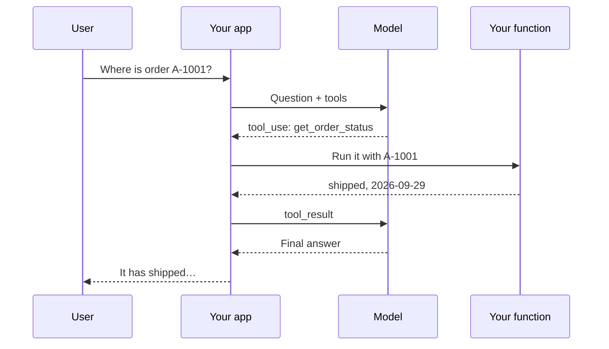
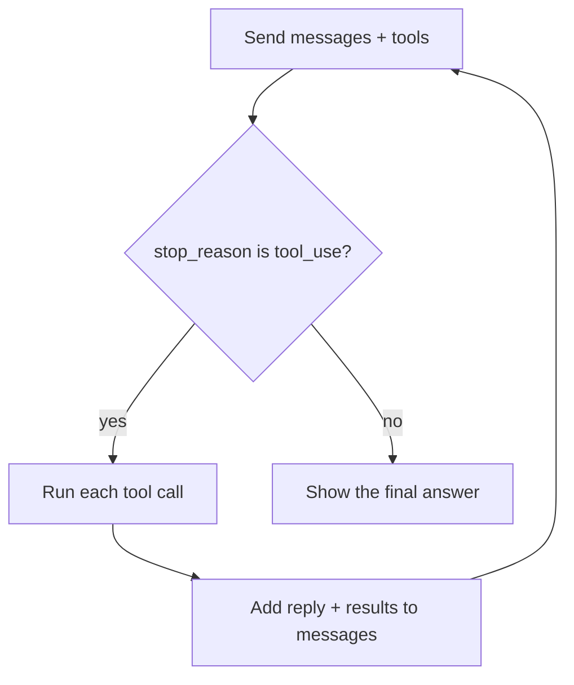

Tool calling lets an AI model ask your code to run a function. The model can only write text, so instead of running anything itself, it replies with a small, structured request: "call `get_order_status` with `order_id: A-1001`". Your code runs the function and sends the result back, and the model uses it to answer.

Anthropic's docs call this [tool use](https://platform.claude.com/docs/en/agents-and-tools/tool-use/overview) and OpenAI's call it [function calling](https://developers.openai.com/api/docs/guides/function-calling). Both pages give the other name too, because it is the same idea. It is the piece that turns a chat model into something that can look things up and take actions in your systems.

## Why does a model need tools?

An [LLM](/blog/what-is-an-llm) turns text into more text. On its own, it can't check your database, call an API or send an email. Ask it "Where is my order A-1001?" and the best it can do is guess. With a tool, the model can say "I need to look this up", and your code does the lookup.

[Anthropic's guide](https://platform.claude.com/docs/en/agents-and-tools/tool-use/how-tool-use-works) lists when tools make sense:

| Use a tool when you need… | Example |
| --- | --- |
| An action with side effects | Send an email, write a file, update a record |
| Fresh or private data | Today's weather, an order in your database |
| Output in a fixed shape | A JSON object with exact fields, not prose |
| A call into an existing system | Your internal API, a file system |

You don't need a tool for summarizing or translating text you already gave the model. Every tool call adds at least one extra round trip.

## How does tool calling work?

The docs describe it as a contract. You say which functions exist and what their input looks like. The model decides when and how to call them. **The model never runs anything on its own**: it sends a request, your code runs the function, and the result goes back into the conversation.

Here is one question, traveling from the user to your function and back:



The model returns a **tool call** (the tool's name and arguments) instead of an answer. Your app runs the function and sends back a **tool result**. The model only ever sees your tool's description and the result you return, never your code.

## How do you describe a tool?

A tool definition has three parts: a name, a description, and an input schema. Here is one from the example later in this post:

```json
{
  "name": "get_order_status",
  "description": "Looks up the shipping status of one customer order by its order id. Use it when the user asks where an order is or when it will arrive. Returns the status and the estimated delivery date. It does not return prices, items or customer details.",
  "input_schema": {
    "type": "object",
    "properties": {
      "order_id": {
        "type": "string",
        "description": "The order id, e.g. A-1001"
      }
    },
    "required": ["order_id"]
  }
}
```

| Field | What it does |
| --- | --- |
| `name` | What the model uses to call the tool. Letters, digits, `_` and `-`, up to 128 characters. |
| `description` | Plain text that says what the tool does, when to use it and what it returns. |
| `input_schema` | A [JSON Schema](https://json-schema.org/) for the arguments: their names, types and which are required. |

JSON Schema is a standard way to describe the shape of JSON data. Here it says: "the input is an object with one required string, `order_id`". You send a list of these in the `tools` field of your API request ([define tools](https://platform.claude.com/docs/en/agents-and-tools/tool-use/define-tools) has every field).

## What does a tool call look like?

When the model wants a tool, the API response has `stop_reason: "tool_use"`, and its `content` holds one or more `tool_use` blocks. Each block has an `id`, the tool `name` and an `input` object that follows your schema:

```json
{
  "type": "tool_use",
  "id": "toolu_01",
  "name": "get_order_status",
  "input": { "order_id": "A-1001" }
}
```

You answer with a new `user` message holding a `tool_result` block whose `tool_use_id` matches the call's `id`, and the output in `content`. You'll build exactly this message in the hands-on step below.

If the function fails, you still send a result: put the error message in `content` and add `"is_error": true`. The model then explains the problem or tries again. The [handle tool calls](https://platform.claude.com/docs/en/agents-and-tools/tool-use/handle-tool-calls) page asks for helpful errors: not "failed", but what went wrong and what to try next.

## What is the tool-calling loop?

One question can need several tool calls: look up the order, see it's delayed, then check the courier. So your app runs a loop: while the model asks for tools, run them and send the results back.



The [how tool use works](https://platform.claude.com/docs/en/agents-and-tools/tool-use/how-tool-use-works) page gives the same shape: keep going while `stop_reason` is `"tool_use"`. Any other stop reason, such as `"end_turn"` (the model is done) or `"max_tokens"` (it ran out of room), ends the loop.

The API keeps no memory between requests, so each time round you send the whole conversation: the question, the model's `tool_use` reply and your `tool_result` blocks.

## Can the model call several tools at once?

Yes. By default, Claude may return several `tool_use` blocks in one response, for example to check two orders at the same time. This is called parallel tool use. The [parallel tool use](https://platform.claude.com/docs/en/agents-and-tools/tool-use/parallel-tool-use) page sets out the rules:

- **You choose how to run them.** Run read-only calls at the same time (for example with `Promise.all`) to save time. Run calls that change data one after another.
- **Send one `tool_result` per `tool_use`**, all in the next `user` message, matched by `tool_use_id`.
- **Tool results come first** in that message. Any text goes after them.
- **Turn it off** with `tool_choice: { type: "auto", disable_parallel_tool_use: true }` if you want at most one call per response.

## What are client tools and server tools?

The main difference between tools is where the code runs. The docs split them into three groups:

| Kind | Who writes the schema | Who runs the code | Examples |
| --- | --- | --- | --- |
| Your own tools | You | Your app | `get_order_status`, a database query, an internal API |
| Anthropic-schema tools | Anthropic | Your app | `bash`, `text_editor`, `memory` |
| Server tools | Anthropic | Anthropic | `web_search`, `web_fetch`, `code_execution` |

The first two are **client tools**: you get a `tool_use` block and run the loop yourself. Most tool calls are this kind, and they're what this post is about. **Server tools** run on Anthropic's side: you turn them on in the request, and the results are already in the response.

## Why do tool descriptions matter so much?

The model decides when to call a tool from the user's request and your tool's name, description and schema. That's all it knows about your function. Anthropic's [define tools](https://platform.claude.com/docs/en/agents-and-tools/tool-use/define-tools) page calls detailed descriptions "by far the most important factor in tool performance", and suggests at least three or four sentences per tool.

Compare two descriptions for the same function:

| Weak | Strong |
| --- | --- |
| "Gets order status." | "Looks up the shipping status of one customer order by its order id. Use it when the user asks where an order is or when it will arrive. Returns the status and the estimated delivery date. It does not return prices, items or customer details." |

The strong one says what the tool does, when to use it, what it returns and what it doesn't. So the model calls it for "where is my order?" and not for "how much did I pay?". The same page also suggests describing each parameter, preferring a few capable tools over many tiny ones, and returning only the fields the model needs.

## Is tool calling the same as function calling?

Yes. OpenAI's [function calling guide](https://developers.openai.com/api/docs/guides/function-calling) says "function calling (also known as tool calling)" and describes the same steps: send tools, get a tool call, run your code, send the output, get the answer. Only the field names differ: OpenAI puts the schema in `parameters` instead of `input_schema`, and results go back as `function_call_output` items with a `call_id`.

## How do you keep tool calling safe?

A tool call is written by a model whose input may include text from users, web pages or emails. Treat it like a request from someone you don't fully trust.


<Callout type="warning" title="The model asks, your code decides">

Tool results can carry instructions hidden in outside content, such as a web page or an email, that try to steer the model. This is called [prompt injection](/blog/prompt-injection-ai-security). Never give a tool more power than you would give the user who is chatting, and ask a person to approve anything that can't be undone.

</Callout>


Four habits cover most of the risk:

- **You decide what can run.** Map tool names to functions in your code, and ignore any name you didn't define. The model can't run anything you didn't write.
- **Validate every input.** The schema guides the model, but check the arguments in your function anyway, like any user input. The [MCP spec](https://modelcontextprotocol.io/specification/latest/server/tools) makes this a rule for tool servers: they must validate all tool inputs.
- **Give each tool the least access it needs.** A tool that reads orders should use a read-only database user. The [OWASP guide on excessive agency](https://genai.owasp.org/llmrisk/llm062025-excessive-agency/) calls this minimizing extension permissions.
- **Keep a person in the loop for risky actions.** Deleting data, sending money or emailing customers should need a human "yes". OWASP recommends human approval for high-impact actions, and the MCP spec says apps should let users deny tool calls.

## How does MCP build on tool calling?

[MCP](/blog/what-is-mcp) (Model Context Protocol) is a standard way to package and share tools, so you don't write every one yourself. An MCP server publishes tools with a name, a description and an `inputSchema`, the same three parts as above. The [MCP architecture docs](https://modelcontextprotocol.io/docs/learn/architecture) describe what the AI app does with them:

1. It asks each connected server for its tools (`tools/list`) and gives the combined list to the model.
2. When the model calls one, the app sends the call to the right server (`tools/call`).
3. It returns the server's result to the model, just like a `tool_result`.

So MCP doesn't replace tool calling; it's tool calling with a shared plug. And when a model runs this loop for many steps on its own until a task is done, you have an agent. [What is an AI agent?](/blog/what-is-an-ai-agent) covers that next.

## Try it: run the tool loop without an API key

You'll run the part of the loop your code owns: read a tool call, run the function, and build the tool result. The model's response is hard-coded in the same shape the API returns, so you need no account and no API key.

**You need:** [Node.js](https://nodejs.org) 22 or later and a terminal in an empty folder.


<Steps>


<Step title="Create the script">


**simulate.mjs**

```js
// Your real function. Here the "database" is a small object in memory.
const orders = {
  'A-1001': { status: 'shipped', eta: '2026-09-29' },
};

function getOrderStatus(input) {
  // Never trust the model's input: check it like any user input.
  const id = input.order_id;
  if (typeof id !== 'string' || !/^A-\d{4}$/.test(id)) {
    throw new Error('order_id must look like A-1234.');
  }
  const order = orders[id];
  if (!order) {
    throw new Error(`No order with id ${id}. Ask the user to check the id.`);
  }
  return order;
}

// Only the functions listed here can ever run.
const handlers = new Map([['get_order_status', getOrderStatus]]);

// A response shaped like the API's when the model wants to use tools.
const response = {
  id: 'msg_01',
  type: 'message',
  role: 'assistant',
  model: 'claude-opus-5-5',
  stop_reason: 'tool_use',
  content: [
    { type: 'text', text: "I'll look up both orders." },
    {
      type: 'tool_use',
      id: 'toolu_01',
      name: 'get_order_status',
      input: { order_id: 'A-1001' },
    },
    {
      type: 'tool_use',
      id: 'toolu_02',
      name: 'get_order_status',
      input: { order_id: 'A-9999' },
    },
  ],
};

// One tool_result per tool_use, matched by its id.
function result(block, content, isError = false) {
  const r = { type: 'tool_result', tool_use_id: block.id, content };
  if (isError) r.is_error = true;
  return r;
}

function runTool(block) {
  const handler = handlers.get(block.name);
  if (!handler) {
    return result(block, `Unknown tool: ${block.name}`, true);
  }
  try {
    const output = handler(block.input);
    return result(block, JSON.stringify(output));
  } catch (err) {
    return result(block, err.message, true);
  }
}

if (response.stop_reason === 'tool_use') {
  const calls = response.content.filter((block) => block.type === 'tool_use');
  for (const call of calls) {
    console.log(`Model asked for ${call.name} ${JSON.stringify(call.input)}`);
  }
  const nextMessage = { role: 'user', content: calls.map(runTool) };
  console.log(JSON.stringify(nextMessage, null, 2));
}
```


The `response` object is what the API sends when the model asks for two tools at once. `runTool` looks up the function by name, runs it, and turns the output or the error into a `tool_result`.

</Step>


<Step title="Run it">

```bash
$ node simulate.mjs
```

You should see:

```text
Model asked for get_order_status {"order_id":"A-1001"}
Model asked for get_order_status {"order_id":"A-9999"}
{
  "role": "user",
  "content": [
    {
      "type": "tool_result",
      "tool_use_id": "toolu_01",
      "content": "{\"status\":\"shipped\",\"eta\":\"2026-09-29\"}"
    },
    {
      "type": "tool_result",
      "tool_use_id": "toolu_02",
      "content": "No order with id A-9999. Ask the user to check the id.",
      "is_error": true
    }
  ]
}
```

</Step>


<Step title="Read the output">

The first order exists, so its result holds the data as a JSON string. The second doesn't, so its result has `is_error: true` and a message the model can pass on to the user. Both results sit in one `user` message, each matched to its call by `tool_use_id`. With a real API, this is the message you send next.

</Step>


<Step title="Break it on purpose">

Change a `name` in the response to `delete_all_orders` and run it again. You get `Unknown tool: delete_all_orders` with `is_error: true`. Only the functions in `handlers` can ever run, whatever the model asks for.

</Step>


</Steps>


### What does the real version look like?

With an API key, the same loop talks to Claude through the official [Anthropic SDK for TypeScript and JavaScript](https://github.com/anthropics/anthropic-sdk-typescript). It follows the round trip in Anthropic's [tool use overview](https://platform.claude.com/docs/en/agents-and-tools/tool-use/overview), wrapped in the loop from the diagram above.


```bash
npm install @anthropic-ai/sdk
```


**agent.mjs**

```js
import Anthropic from '@anthropic-ai/sdk';

// Reads ANTHROPIC_API_KEY from the environment.
const client = new Anthropic();

const tools = [
  {
    name: 'get_order_status',
    description:
      'Looks up the shipping status of one customer order by its order id. ' +
      'Use it when the user asks where an order is or when it will arrive. ' +
      'Returns the status and the estimated delivery date. ' +
      'It does not return prices, items or customer details.',
    input_schema: {
      type: 'object',
      properties: {
        order_id: {
          type: 'string',
          description: 'The order id, e.g. A-1001',
        },
      },
      required: ['order_id'],
    },
  },
];

const orders = { 'A-1001': { status: 'shipped', eta: '2026-09-29' } };

function getOrderStatus({ order_id }) {
  if (typeof order_id !== 'string' || !/^A-\d{4}$/.test(order_id)) {
    throw new Error('order_id must look like A-1234.');
  }
  const order = orders[order_id];
  if (!order) throw new Error(`No order with id ${order_id}.`);
  return order;
}

const handlers = new Map([['get_order_status', getOrderStatus]]);

function runTool(block) {
  try {
    const handler = handlers.get(block.name);
    if (!handler) throw new Error(`Unknown tool: ${block.name}`);
    const output = handler(block.input);
    return {
      type: 'tool_result',
      tool_use_id: block.id,
      content: JSON.stringify(output),
    };
  } catch (err) {
    return {
      type: 'tool_result',
      tool_use_id: block.id,
      content: err.message,
      is_error: true,
    };
  }
}

const messages = [{ role: 'user', content: 'Where is my order A-1001?' }];

let response = await client.messages.create({
  model: 'claude-opus-5-5',
  max_tokens: 1024,
  tools,
  messages,
});

// The loop: keep going while the model asks for tools.
while (response.stop_reason === 'tool_use') {
  const calls = response.content.filter((b) => b.type === 'tool_use');
  messages.push(
    { role: 'assistant', content: response.content },
    { role: 'user', content: calls.map(runTool) },
  );
  response = await client.messages.create({
    model: 'claude-opus-5-5',
    max_tokens: 1024,
    tools,
    messages,
  });
}

for (const block of response.content) {
  if (block.type === 'text') console.log(block.text);
}
```


This one needs an API key. Create one in the [Claude Console](https://platform.claude.com/), set it as the `ANTHROPIC_API_KEY` environment variable (the SDK reads it from there), and run it:

```bash
$ node agent.mjs
```

It prints Claude's final answer, written from the data your function returned. API calls are billed per token, and the tool definitions count as input tokens.

## What should I do next?

- **Run `simulate.mjs` and change it.** Add a second tool, such as `cancel_order`, and think about which checks it needs before it may run.
- **Read [What is MCP?](/blog/what-is-mcp)** to see how apps like Claude Code get ready-made tools from MCP servers.
- **Read Anthropic's [build a tool-using agent](https://platform.claude.com/docs/en/agents-and-tools/tool-use/build-a-tool-using-agent) tutorial** when you're ready to run the real loop.
- **Next in this series:** [What is an AI agent?](/blog/what-is-an-ai-agent) Agents run this loop many times on their own to finish a task.
