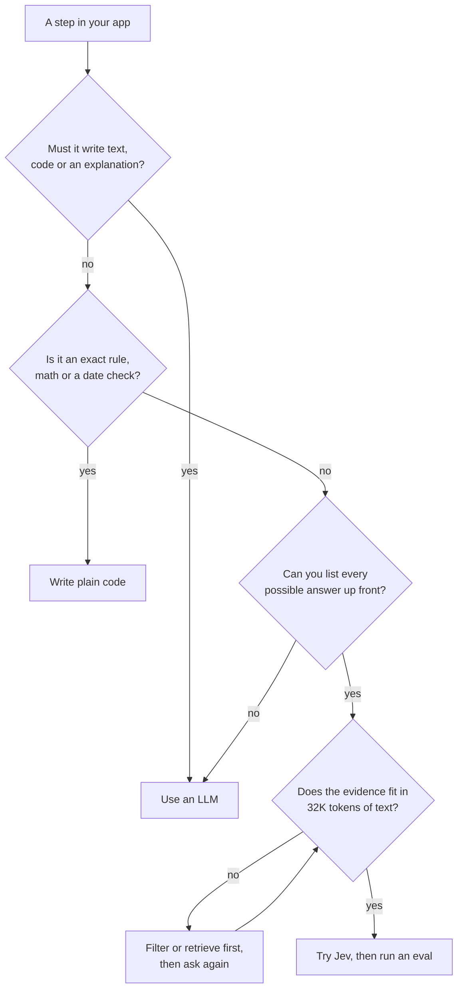
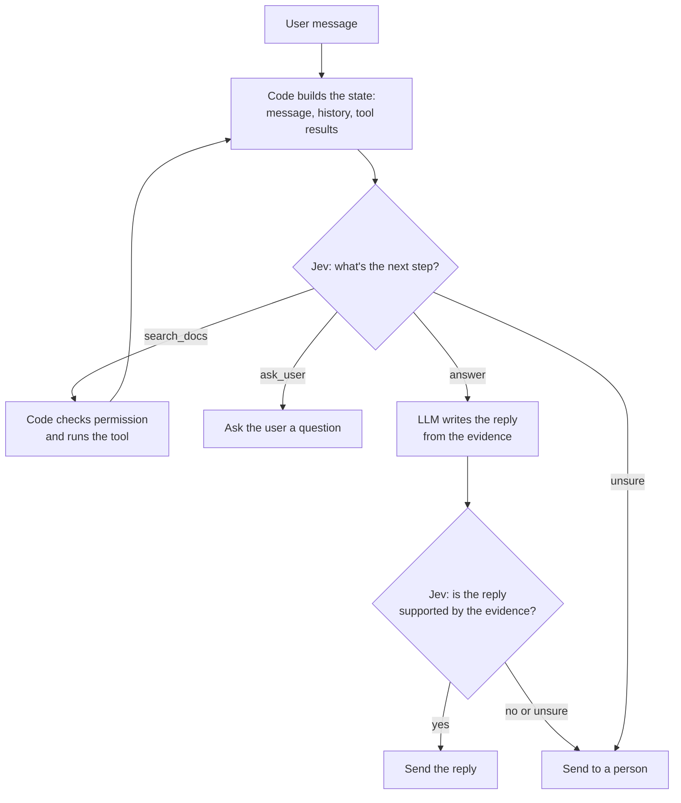

Use Jev for steps that **decide**: pick a queue, set a flag, give a score on your rubric, check a claim, or choose an agent's next step. Keep an LLM for steps that **write** or **reason** in many steps. The simple test: if you can list every possible answer before you see the input, the step is a candidate for Jev. If the answer is text you can't list in advance, it's a job for an LLM.

Most real apps need both. This guide shows which jobs fit where, how the two work together in an agent, how to act on Jev's probabilities safely, and what the switch can save. The earlier parts of this series explain [what Jev is](/blog/what-is-jev) and [how a decision model differs from an LLM](/blog/jev-vs-llms). Here we focus on the choice.

## What makes a job a good fit for Jev?

Jev is a decision model from TypeSafe AI. You send it a **state** (the text or JSON it should look at) and a set of typed **questions**. It returns typed answers with probabilities, not text. On [Vercel AI Gateway](https://vercel.com/docs/ai-gateway/modalities/evaluation) there are three question types:

| Question type | What it answers | Example answer |
| --- | --- | --- |
| Choice | Which one of these options? | `choice: 'billing'` plus a probability for each option |
| Score | Where on this ordered scale? | `score: 2.97` on a scale you define |
| Boolean | Is this statement true? | `probability: 0.98` |

So a good job for Jev has three things:

1. **A closed set of answers.** You can name the options, the scale levels or the yes/no statement up front.
2. **The evidence is in the input.** Everything needed to decide fits in the state. Jev doesn't look things up.
3. **A quick judgment is enough.** TypeSafe's [docs](https://docs.typesafe.ai/introduction) describe each question as the kind of call "a highly knowledgeable person could make in a few seconds given the right context". If a question needs long reasoning, split it into smaller questions and combine the answers in code.

These jobs fit that shape, and each one comes from the official docs or follows directly from the question types:

| Job | Question type | Where it comes from |
| --- | --- | --- |
| Route a support ticket to billing, technical or account | Choice | The Gateway docs' Choice example routes a support ticket |
| Flag content for review, such as a product review or a risky message | Boolean or Score | Vercel's [review moderation guide](https://vercel.com/kb/guide/moderate-product-reviews-jev-tanstack-ai) and TypeSafe's [guardrails cookbook](https://docs.typesafe.ai/cookbooks/llm_guardrails) |
| Score a lead, a ticket's urgency or a pull request's quality | Score | Score rates the state on a rubric you define; the docs show urgency and PR quality |
| Check "is this answer grounded in the source?" | Boolean or Choice | TypeSafe's [citation-check cookbook](https://docs.typesafe.ai/cookbooks/citation_check); the Gateway lists "automated verification" |
| Pick an agent's next step or subagent | Choice | The [launch changelog](https://vercel.com/changelog/typesafe-ai-jev-now-available-on-ai-gateway) lists choosing the next tool or subagent, and whether to continue, retry, ask the user or stop |
| Grade answers against a rubric | Score | The [Jev model page](https://vercel.com/ai-gateway/models/jev) lists "rubric-based assessment" |

Lead scoring is not a named example in the docs. It fits because it's the same shape as the urgency example: a rubric with a few ordered levels, where you describe each level in plain words.

## When do you still need an LLM?

Some jobs don't fit, and TypeSafe says so plainly. Its list of [known weak spots for Jev 1.13](https://docs.typesafe.ai/model-jaggedness/jev-1.13) is worth reading in full before you build.

| Job | Why Jev is the wrong tool | Use instead |
| --- | --- | --- |
| Write a reply, a summary, code or an explanation | TypeSafe says its decision models "do not write replies, produce code, or generate explanations of their reasoning" ([docs](https://docs.typesafe.ai/concepts/system-one)) | An LLM |
| Open-ended or multi-step reasoning | TypeSafe says to split questions that need extended reasoning, and lists multi-hop "System Two" tasks as a weak spot | An LLM, or split into atomic questions |
| Read a long document or a big codebase | The state plus the longest question must fit in 32,000 tokens, and the whole request in 64,000. The Gateway listing shows a 32K context | Filter or retrieve first, or use an LLM with a large context window |
| Math, counting, comparing dates | TypeSafe: "Jev is not a calculator" and "does not count reliably" | Plain code |
| An exact rule, like "is this account active?" | A fully specified rule should run in code ([Vercel](https://vercel.com/i/when-to-use-jev)) | Plain code |
| Images, audio or video | Jev accepts text only | Convert to text first, or use a multimodal LLM |

Two more limits matter in practice. English is Jev's primary training language, so test carefully if your traffic is in other languages. And accuracy drops when the state is full of details that don't matter to the question, so send only what the decision needs.

Here's the whole choice as one flowchart:



## How do Jev and an LLM work together in an agent?

An [AI agent](/blog/what-is-an-ai-agent) is a loop: a model looks at the situation, picks an action, your code runs it, and the result goes back in. Many of the steps in that loop are decisions, not writing. That's where Jev fits.

A useful split of the work:

- **Jev decides**: which tool to use next, whether to ask the user, whether a draft answer is supported by the sources.
- **The LLM writes and reasons**: the final reply, a summary of the evidence, anything open-ended.
- **Your code controls**: permission checks, running tools, updating the state, and limits on retries.

Vercel's article on [Jev in an agent loop](https://vercel.com/i/jev-agent-control) makes the last point strongly: a model's choice is only input to your code. The permission check must be real code that runs before every tool call, not an instruction in a prompt.



One detail shapes how you design this loop: Jev answers all the questions in one request independently, against the same state. That makes it cheap to ask several questions at once, such as "which tool?" and "is this request urgent?". But a question can't use another question's answer. If step two depends on the result of step one, make two requests.

## How do I act on Jev's probabilities safely?

Every Jev answer comes with probabilities. A Boolean answer is the probability that the statement is true: 0.98 is a strong yes, 0.02 is a strong no, and 0.5 means the model can't tell. A Choice answer gives a probability for each option.

Turn those numbers into three paths:

| Probability of the chosen answer | What your code does |
| --- | --- |
| Above your threshold | Act automatically |
| Below the threshold | Ask a person, ask the user to confirm, or retry with a bigger model |
| Missing (the model returned no distribution) | Treat it as unsure. Never replace it with 0 or 1 |

Where you put the threshold depends on what a mistake costs. Vercel's [AI SDK guide](https://vercel.com/kb/guide/typesafe-jev-and-ai-sdk) suggests about 0.7 might be enough for a read-only action like showing a screen, and 0.9 or higher, plus a confirmation step, for anything destructive. Those are starting points, not answers. Test them on labeled examples from your own traffic.

For the "retry with a bigger model" path, AI Gateway has opt-in [evaluation fallbacks](https://vercel.com/docs/ai-gateway/modalities/evaluation#escalating-uncertain-evaluations): when Jev's answer is uncertain, the Gateway reruns the request on another model. Both calls are billed, and the request takes as long as both together.


<Callout type="warning" title="A probability is not a permission">

A high probability that "the customer asked for a refund" does not mean the refund is allowed. Keep classification and authorization apart: Jev tells you what the request is, and your code checks account status, policy and permissions before anything happens. Also remember that the state is data Jev reads: TypeSafe notes that text written to steer the model, such as an injected instruction, [can move the answer](/blog/prompt-injection-ai-security).

</Callout>


## How much can switching save?

Here are today's prices, per million tokens (MTok):

| Model | Input | Output | Source |
| --- | --- | --- | --- |
| Jev (`typesafe-ai/jev` on AI Gateway) | $0.042 / MTok | $0 | [Jev model page](https://vercel.com/ai-gateway/models/jev) |
| Claude Haiku 4.5 (`claude-haiku-4-5`) | $1 / MTok | $5 / MTok | [Anthropic pricing](https://platform.claude.com/docs/en/about-claude/pricing) |

Haiku 4.5 is the cheapest current Claude model, so it's the fairest LLM to compare against for a routing job. AI Gateway also lists it at $1 and $5, and the Gateway [adds no markup](https://vercel.com/docs/ai-gateway/pricing) to provider prices.

Say you route **1 million support tickets a month**. Each request reads 500 input tokens. The LLM answers with a short label of about 20 tokens. To keep the math simple, assume both models count the same number of tokens; in reality each model has its own tokenizer, so real counts differ.

| Cost per month | Jev | Claude Haiku 4.5 |
| --- | --- | --- |
| Input: 500 million tokens | $21.00 | $500.00 |
| Output: 20 million tokens | $0 | $100.00 |
| **Total** | **$21.00** | **$600.00** |

That's about 29 times cheaper for this job. The Gateway docs show why output is free: their sample Jev response reports 275 input tokens and 20 output tokens, and a cost of $0.00001155, which is exactly 275 tokens at $0.042 per million.

Speed is harder to compare without running your own test. TypeSafe reports end-to-end times of 70 to 500 milliseconds on its [launch blog](https://typesafe.ai/blog/introducing-system-one-models-and-jev). Its headline "193.6x faster, 444.6x cheaper" comes from TypeSafe's own workflow benchmarks, and TypeSafe itself says these are likely "on the higher end of real world gains". Treat all of these as the vendor's numbers, not a promise for your app. For the general levers on cost and speed, see [AI cost and latency](/blog/ai-cost-and-latency).

## What are the risks of switching?

- **It's a proprietary, hosted model.** You call Jev over an API, from TypeSafe or a provider like AI Gateway or Cloudflare. TypeSafe's [customer agreement](https://typesafe.ai/legal/mca) forbids reverse engineering the service or training a model to imitate it. If prices or limits change, your only options are the providers that serve it.
- **It's brand new.** Jev launched on 15 September 2026. The AI SDK function is still named `experimental_evaluate`, and the AI SDK docs say the API "may change in patch releases". TypeSafe says its rate limits "can change without notice" while demand is high.
- **Answers can shift under an alias.** The `jev-latest` alias moves when TypeSafe ships a new version. If you tune thresholds against one version, TypeSafe suggests pinning that version and moving on your own schedule.
- **Calibrated doesn't mean correct.** Calibration means that across many answers at 0.8, about 80% are right. Any single answer can still be wrong.

The fix for all four is the same: [run an eval](/blog/test-ai-output-with-evals) before you switch. Label a few hundred real cases, including the messy and ambiguous ones. Run your current setup and Jev on the same cases. Compare wrong actions, how many cases go to review, cost and speed. Then pick the threshold from those results, and keep a way to switch back.

## Try it: route tickets with a threshold

This runs without an API key. It uses the real AI SDK function, `experimental_evaluate`, with a stand-in model from `ai/test` that returns fixed answers. You'll see both paths of the policy: act, or ask a person.

**You need:** Node.js 22 or later.


<Steps>


<Step title="Create a project and install the AI SDK">

```bash
$ mkdir jev-route && cd jev-route
$ npm init -y
```


```bash
npm install ai@latest
```


Evaluation needs AI SDK 7.0.105 or later.

</Step>


<Step title="Write the routing policy">


**route.mjs**

```js
import { experimental_evaluate as evaluate } from 'ai';
import { Experimental_EvaluationMockModelV4 as MockEvaluationModel } from 'ai/test';

// Your policy: how sure the model must be before code acts alone.
const AUTO_ROUTE = 0.9;

async function routeTicket(model, message) {
  const { answers } = await evaluate({
    model,
    state: { message },
    questions: {
      team: {
        type: 'choice',
        instructions: 'Which team should handle this support ticket?',
        criteria: {
          billing: 'Charges, invoices and refunds',
          technical: 'Bugs, outages and integration failures',
          account: 'Login, permissions and profile changes',
        },
      },
    },
  });

  const { choice, probabilities } = answers.team;
  const p = probabilities?.[choice];
  if (p == null || p < AUTO_ROUTE) {
    return { action: 'ask-a-human', guess: choice, p };
  }
  return { action: 'route', team: choice, p };
}

// A stand-in for Jev that returns fixed answers, so this runs without an API key.
function fakeJev(choice, probabilities) {
  return new MockEvaluationModel({
    doEvaluate: async () => ({
      answers: { team: { type: 'choice', choice, probabilities } },
      warnings: [],
    }),
  });
}

console.log(await routeTicket(
  fakeJev('billing', { billing: 0.96, technical: 0.03, account: 0.01 }),
  'I was charged twice for my subscription this month.',
));
console.log(await routeTicket(
  fakeJev('account', { billing: 0.4, technical: 0.1, account: 0.5 }),
  "I can't log in, and I think my card was charged again.",
));
```


- `AUTO_ROUTE` is your policy, in code. Change it without touching the question.
- `probabilities?.[choice]` reads the chosen option's probability. If there's no distribution, `p` is `undefined` and the ticket goes to a person.
- `fakeJev` returns fixed answers: a clear billing ticket, and a mixed ticket where no team is a clear winner.

</Step>


<Step title="Run it">

```bash
$ node route.mjs
```

```text
{ action: 'route', team: 'billing', p: 0.96 }
{ action: 'ask-a-human', guess: 'account', p: 0.5 }
```

The clear ticket is routed. The mixed one, a login problem plus a billing question, goes to a person, even though the model had a best guess.

</Step>


<Step title="Swap in the real model (needs an AI Gateway key)">

Replace each `fakeJev(...)` argument with the string `'typesafe-ai/jev'`, and set `AI_GATEWAY_API_KEY` in your environment. The AI SDK sends string model IDs through AI Gateway. The routing code doesn't change, because the answer has the same shape. [How to test Jev on Vercel AI Gateway](/blog/test-jev-on-vercel-ai-gateway) walks through keys and credits for real calls.

</Step>


</Steps>


## What should I do next?

- **List the decisions in your app.** Go through one AI feature or agent and mark each step as write, reason, rule or decide. The "decide" steps are your candidates.
- **Build a small eval for one of them** with the method in [How to test AI output with evals](/blog/test-ai-output-with-evals), then compare your current model and Jev on the same cases.
- **Read TypeSafe's [known weak spots](https://docs.typesafe.ai/model-jaggedness/jev-1.13)** before you write your questions. It will save you from the common mistakes.
- **Continue the series.** [Build your first Jev app](/blog/build-your-first-jev-app) turns this into a working script, and [How to test Jev on Vercel AI Gateway](/blog/test-jev-on-vercel-ai-gateway) shows how to get access for real calls.
