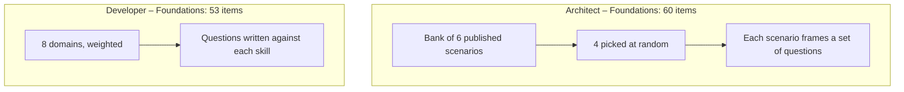
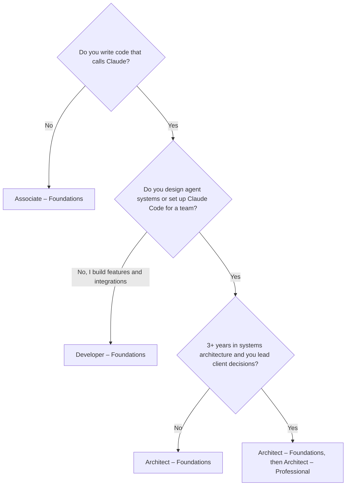

If you write the code that calls Claude, take **Claude Certified Developer – Foundations** first. If you design agent systems for clients and set up Claude Code for whole teams, take **Claude Certified Architect – Foundations** first. Both exams cost the same and take the same time; the difference is what they test and how the questions are built.

This post compares the two side by side, using only Anthropic's own exam guides and certification pages as they read on 30 September 2026. It ends with a short self-check that tells you which exam fits you better today.

## Which Claude certifications are there?

In July 2026 Anthropic [expanded its certification program](https://claude.com/blog/four-role-based-claude-certifications) to four exams. Two of them are the technical Foundations exams this post compares:

- **Developer – Foundations**, "for engineers building applications with Claude".
- **Architect – Foundations**, "for solution architects who design and build agent systems with Claude".

The other two, in one line each: **Associate – Foundations** ($99) is for people who use Claude without writing code, and its guide says it is "not intended for software developers who build against APIs". **Architect – Professional** ($175) is "the advanced credential" for large-enterprise integration, governance and evaluation. The first post in this series, [What Claude certifications are there, and can you take one?](/blog/what-are-claude-certifications), covers all four.

## How do the Developer and Architect exams compare?

Here are the two exams side by side. Every fact comes from the official exam guide, which is the PDF linked from each certification page: [Developer – Foundations](https://anthropic-partners.skilljar.com/claude-certified-developer-foundations-certification) and [Architect – Foundations](https://anthropic-partners.skilljar.com/claude-certified-architect-foundations-certification).

| | Developer – Foundations | Architect – Foundations |
| --- | --- | --- |
| Exam code | CCDV-F | CCAR-F |
| Number of items | 53 | 60 |
| Time | 120 minutes | 120 minutes |
| Structure | 8 domains | 5 domains, asked through 4 scenarios picked from a bank of 6 |
| Item types | Multiple choice and multiple response | Multiple choice and multiple response |
| Passing score | 720 on a 100–1,000 scale | 720 on a 100–1,000 scale |
| Fee | $125 | $125 |
| Valid for | 12 months | 12 months |
| Recommended experience | 1–5 years of software engineering, 6+ months with Claude or a similar LLM system, Python and/or TypeScript | 6+ months building with the Claude APIs, Agent SDK, Claude Code and MCP |
| Required courses | None | None listed |
| Sample questions in the guide | 3 | 12, plus 4 hands-on preparation exercises |
| Out-of-scope list | Not published | Published (16 topics) |

Some terms from the table, in plain words:

- **Scaled score:** your raw result is converted to a 100–1,000 scale, so results from exam versions of slightly different difficulty can be compared. You pass at 720 or more.
- **Multiple response:** a question with more than one right answer. Each item tells you how many to pick.
- **Domain:** a topic area of the exam. Its weight is roughly the share of questions drawn from it.

The practical facts are the same for both. You book through the Anthropic Partner Academy, pay, and then schedule with Pearson VUE, online or at a test center. The [certification FAQ](https://anthropic-partners.skilljar.com/page/faq-certifications) adds that exams are closed book, in English only, and that you should plan for about 135 minutes of seat time. Renewing on time is a free, unproctored assessment.

## Who is each exam for?

The two guides describe different people.

**Developer – Foundations** is for "AI and machine learning engineers, technical leads, and senior software engineers" who "build, integrate, and ship" Claude applications. The guide expects you to be fluent with REST APIs and command-line tools. It also says who it is *not* for: people without hands-on software development experience, and "roles limited to prompt writing".

**Architect – Foundations** is for "a solution architect who designs and implements production applications with Claude". Its experience list is specific to Claude's own tools: building multi-agent apps with the Claude Agent SDK, configuring Claude Code for teams with CLAUDE.md files, Skills and MCP servers, designing MCP tools, and putting Claude into CI/CD pipelines.

So the split is not "junior versus senior". It is **breadth versus depth**. The Developer exam checks that you can ship a solid Claude app of any kind. The Architect exam checks that you can make good design calls in agentic systems built on Anthropic's own stack.

## What does each exam test?

The domain weights show the difference fastest.


**Developer – Foundations: domain weights**

| domain | weight |
| --- | --- |
| Apps | 33.1 |
| Models | 16.8 |
| Agents | 14.7 |
| Prompts | 11.0 |
| Tools | 10.6 |
| Security | 8.1 |
| Code | 3.1 |
| Evals | 2.6 |


A third of the Developer exam is **Applications and Integration**: how the Claude API behaves (messages, tools, streaming, vision, thinking, caching, batches), plus general software engineering such as REST, JSON, async code, version control and refactoring. Model choice and cost come next. Claude Code is only 3.1%.


**Architect – Foundations: domain weights**

| domain | weight |
| --- | --- |
| Agents | 27 |
| Claude Code | 20 |
| Prompts | 20 |
| Tools and MCP | 18 |
| Context | 15 |


The Architect exam puts over a quarter of its weight on **agentic architecture**: agent loops, a coordinator agent handing work to subagents, hooks, and sessions. Claude Code configuration is a full fifth of the exam: CLAUDE.md files, path-specific rules, custom commands and skills, and when to use plan mode. If CLAUDE.md is new to you, start with [getting the most out of AI coding assistants](/blog/ai-coding-assistants-tips).

The clearest way to see the split is to look at topics one exam covers and the other leaves out. The Architect guide publishes a list of topics that "will not appear on the exam", and several of them are named in the Developer blueprint:

| Topic | Developer – Foundations | Architect – Foundations |
| --- | --- | --- |
| Streaming responses | In scope (Claude API mechanics) | Out of scope |
| Vision (image input) | In scope (Claude API mechanics) | Out of scope |
| Prompt caching | In scope (cost and token management) | Out of scope beyond knowing it exists |
| Cost modelling and pricing | In scope | Out of scope |
| API keys and secrets | In scope (identity, secrets and key management) | Out of scope |
| Deploying MCP servers | In scope (MCP server development) | Out of scope |
| Claude Code configuration | 3.1% | 20% |
| Multi-agent orchestration | Part of agents and workflows (14.7%) | Core of the largest domain (27%) |

If the left column is your daily work, the Developer exam matches it. If the right column is, the Architect exam does. For background on the terms, see [what MCP is](/blog/what-is-mcp), [tool calling](/blog/what-is-tool-calling) and [AI cost and latency](/blog/ai-cost-and-latency).

## How are the questions different?

Both exams use the same item types, and every item tells you how many answers to select. The difference is how questions are grouped.



**Architect – Foundations is built on scenarios.** A scenario is a short description of a real project, and several questions follow from it. The guide publishes all six: a customer support resolution agent, code generation with Claude Code, a multi-agent research system, developer productivity with Claude, Claude Code for continuous integration, and structured data extraction. You get four of them at random, so you must be ready for all six. With 60 items in 120 minutes, you have about two minutes per item, including reading the scenario.

**Developer – Foundations is organised by skill.** Its guide lists no scenario bank. Instead it breaks each domain into weighted skills, such as "Claude API Mechanics (6.8%)" or "Claude Hooks (1.0%)", and exam items are written against those. With 53 items in 120 minutes, you have a little over two minutes per item.

Both guides include sample questions with explanations. Read them before you book: they show the style better than any description. The Architect guide says its samples come from the practice test; the Developer guide says its samples are illustrative and not from the live item bank.


<Callout type="warning" title="Don't share or look for real exam questions">

Before each exam you accept a non-disclosure agreement: questions, answer options and scenarios are Anthropic's confidential property. Under the guides' rules of conduct, disclosing exam content can lead to your result being invalidated, your credential revoked and a ban from future exams. Study from the guides and your own practice, not from "leaked" question dumps.

</Callout>


## Which one should you take first?

Anthropic gives one rule of thumb for order. Its [certifications page](https://anthropic-partners.skilljar.com/page/partner-certifications) says: "Each certification maps to the work you already do. Start at Foundations, then advance to Professional where available." The FAQ adds that Architect – Foundations "is the natural place to start" before Architect – Professional, but that there is no formal prerequisite.

Anthropic does **not** say whether to take Developer or Architect first. So pick by the work you do every week:



In words:

- **You write the code.** You call the API, build features, handle errors and ship. Take **Developer – Foundations**. Its weight on API mechanics, model choice, cost and security matches your job.
- **You design systems for clients.** You decide how agents split work, which tools they get, how Claude Code is set up for a team, and where a human steps in. Take **Architect – Foundations**.
- **You do both.** Many tech leads do. Our suggestion, not Anthropic's: if you already build with the Claude Agent SDK and maintain your team's Claude Code setup, start with Architect – Foundations. If you mostly build on the Claude API, start with Developer. The self-check below makes this concrete.
- **You lead enterprise designs.** Architect – Professional recommends 3+ years in systems architecture; Anthropic's order is Foundations first, then Professional.
- **You use Claude but don't write code.** Associate – Foundations fits, but it does not count toward your firm's partner tier; Developer and both Architect exams do.


<Callout type="note" title="Partner organizations only, for now">

The [certification FAQ](https://anthropic-partners.skilljar.com/page/faq-certifications) says exams are currently available only to people at Claude Partner Network organizations, and you register with your company email. Firms can [join the network for free](https://claude.com/partners). If your employer isn't a partner yet, you can still learn the material through [Anthropic Academy's free courses](https://academy.claude.com/).

</Callout>


## Try it: rate yourself against both blueprints

This small script weights your own ratings by each exam's domain weights. It gives a rough picture of which blueprint fits you better today and which domains to study first. It is a self-check, not a prediction of your exam score.

**You need:** Node.js 22 or later.


<Steps>


<Step title="Save the script">

Create a file called `readiness.mjs` and paste this in. Change the second number in each row to your own rating from 0 to 3.


**readiness.mjs**

```js
// Rate yourself 0-3 per domain: 0 = never done it, 1 = read about it,
// 2 = done it once or twice, 3 = do it at work.
// Weights are copied from each exam guide (July 2026).
const exams = {
  'Developer – Foundations': {
    'Agents and Workflows': [14.7, 2],
    'Applications and Integration': [33.1, 3],
    'Claude Code': [3.1, 2],
    'Eval, Testing, and Debugging': [2.6, 1],
    'Model Selection and Optimization': [16.8, 2],
    'Prompt and Context Engineering': [11.0, 2],
    'Security and Safety': [8.1, 1],
    'Tools and MCPs': [10.6, 2],
  },
  'Architect – Foundations': {
    'Agentic Architecture & Orchestration': [27, 1],
    'Tool Design & MCP Integration': [18, 2],
    'Claude Code Configuration & Workflows': [20, 2],
    'Prompt Engineering & Structured Output': [20, 2],
    'Context Management & Reliability': [15, 1],
  },
};

for (const [exam, domains] of Object.entries(exams)) {
  let score = 0;
  const gaps = [];
  for (const [name, [weight, rating]] of Object.entries(domains)) {
    score += (weight / 100) * (rating / 3);
    if (rating < 2) gaps.push(`${name} (${weight}%)`);
  }
  console.log(`${exam}: self-rating ${Math.round(score * 100)} of 100`);
  console.log(`  Study first: ${gaps.join(', ') || 'nothing below 2'}`);
}
```


</Step>


<Step title="Run it">

```bash
$ node readiness.mjs
```

With the example ratings, you'll see:

```text
Developer – Foundations: self-rating 74 of 100
  Study first: Eval, Testing, and Debugging (2.6%), Security and Safety (8.1%)
Architect – Foundations: self-rating 53 of 100
  Study first: Agentic Architecture & Orchestration (27%), Context Management & Reliability (15%)
```

</Step>


<Step title="Read the result">

The higher number is the exam that fits your experience today. The "Study first" list shows the domains you rated below 2. A gap in a heavy domain, like the 27% agentic architecture domain above, matters much more than a gap in a light one.

</Step>


<Step title="Check against the guide">

Open the exam guide for the exam you picked and read each domain's full description. Rate yourself again with the detail in front of you. People often rate themselves higher before they read the details.

</Step>


</Steps>


## What should I do next?

- **Download the guide for the exam you picked** from its certification page ([Developer](https://anthropic-partners.skilljar.com/claude-certified-developer-foundations-certification) or [Architect](https://anthropic-partners.skilljar.com/claude-certified-architect-foundations-certification)) and read it in full. It is the official source for what the exam covers.
- **Close your biggest gap with a build.** For the Architect exam, [build your first AI agent](/blog/build-your-first-ai-agent). For the Developer exam, start with [your first LLM API call](/blog/first-llm-api-call) and [prompt injection and AI security](/blog/prompt-injection-ai-security).
- **Make a study plan.** The next post in this series, [How to prepare for the Claude Certified Architect exam: a study plan](/blog/claude-architect-exam-study-plan), turns the Architect guide into a week-by-week plan.
