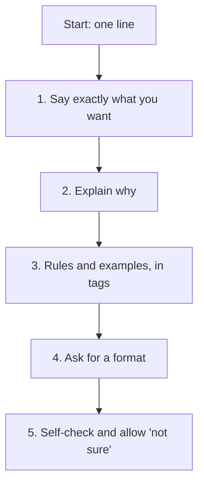

To write an effective prompt, start with your one-line request and add five things: exactly what you want, why you want it, the rules with a few examples, the shape of the answer, and permission to say "I'm not sure". In this guide you'll do that to one real task, a function that validates email addresses, and see what each change fixes.

You don't need any code or API key. Every prompt works in any AI chat app, such as Claude or ChatGPT. The techniques come from Anthropic's [prompting best practices](https://platform.claude.com/docs/en/build-with-claude/prompt-engineering/claude-prompting-best-practices). If you want the ideas behind them first, read the earlier post in this series, [What is prompt engineering?](/blog/what-is-prompt-engineering).

## What do you need?

- **An AI chat app** you already use.
- **Optional:** [Node.js](https://nodejs.org) 22 or later, to run the tests the model writes at the end.
- **About 15 minutes.**

One habit makes this work: **start a new chat for each version of the prompt.** The model reads the whole conversation, as [What is an LLM?](/blog/what-is-an-llm) explains, so an earlier answer can shape the next one. A fresh chat makes it a fair comparison.

## Where do you start?

Here is the prompt most of us would type first:

```text
write a function that validates email addresses
```

Send it and look at the answer. The model has to guess almost everything:

- **Which language?** It might pick Python when you wanted JavaScript.
- **How strict?** "Valid email" can mean anything from "has an @" to a very long regular expression.
- **What do you get back?** Only the function, or a long explanation too? Any tests?

Each guess is a chance to get something you can't use. The next five steps remove the guesses one at a time.



## How do you improve the prompt, step by step?

Make one change, send the new version in a new chat, and compare it with the last answer.


<Steps>


<Step title="Say exactly what you want">

```text
Write a JavaScript function isValidEmail(email) for Node.js 22 that returns
true or false. Use no external libraries.
```

**What it fixes:** the language, the name, the input and output, and the "just install a package" answer. Anthropic's docs say the model responds well to [clear, explicit instructions](https://platform.claude.com/docs/en/build-with-claude/prompt-engineering/claude-prompting-best-practices#be-clear-and-direct) and that you should be specific about the output and its limits. Start with an action verb, like "Write".

</Step>


<Step title="Explain why you need it">

```text
Write a JavaScript function isValidEmail(email) for Node.js 22 that returns
true or false. Use no external libraries.

It checks the email field of a sign-up form before we send a confirmation
email. It only needs to catch typos, because the confirmation email proves the
address is real. Rejecting a real user's address is worse than letting an odd
one through.
```

**What it fixes:** how strict the check should be. Without the reason, the model has to guess. With it, the model knows a simple, forgiving check is the goal. The docs call this [adding context](https://platform.claude.com/docs/en/build-with-claude/prompt-engineering/claude-prompting-best-practices#add-context-to-improve-performance): when you explain why a rule matters, the model can apply that reason to cases you didn't list.

</Step>


<Step title="List the rules, add examples, and put each part in a tag">

```text
<context>
I'm adding a sign-up form to a Node.js 22 web app. This function checks the
email field before we send a confirmation email. It only needs to catch typos,
because the confirmation email proves the address is real. Rejecting a real
user's address is worse than letting an odd one through.
</context>

<task>
Write a JavaScript function isValidEmail(email) that returns true or false.
</task>

<requirements>
- Plain JavaScript as an ES module, exported from a file named email.mjs.
- No external libraries.
- Exactly one @, with text before it and a domain after it.
- The domain must contain at least one dot.
- No spaces anywhere.
</requirements>

<examples>
ana@example.com -> true
first.last+news@example.org -> true
ana@ -> false
ana.example.com -> false
ana@@example.com -> false
ana@example -> false
ana @example.com -> false
</examples>
```

**What it fixes:** the edge cases. "Is `ana@example` valid?" is now answered by an example instead of a guess. Anthropic calls examples [one of the most reliable ways](https://platform.claude.com/docs/en/build-with-claude/prompt-engineering/claude-prompting-best-practices#use-examples-effectively) to steer the output, and asks for examples that are relevant and varied, so the model doesn't copy a pattern you didn't mean. That's why the list mixes valid and invalid addresses.

The tags are just labels. The names are yours to choose; they only show where the context ends and the rules begin. [XML-style tags](https://platform.claude.com/docs/en/build-with-claude/prompt-engineering/claude-prompting-best-practices#structure-prompts-with-xml-tags) help when a prompt mixes instructions, context and data. Clear headings work too.

</Step>


<Step title="Ask for the format you want">

Add this block after `</examples>`:

```text
<format>
1. The function in one code block.
2. Tests for every example, in a file named email.test.mjs, using node:test
   and node:assert/strict.
3. At most three bullet points on what the function does not check.
</format>
```

**What it fixes:** the shape of the answer. You get the code, tests you can run, and a short list of limits, instead of a long essay. The docs recommend being [specific about the desired output format](https://platform.claude.com/docs/en/build-with-claude/prompt-engineering/claude-prompting-best-practices#be-clear-and-direct), and saying what you want rather than [what you don't want](https://platform.claude.com/docs/en/build-with-claude/prompt-engineering/claude-prompting-best-practices#control-the-format-of-responses).

</Step>


<Step title="Ask for a self-check and allow 'I'm not sure'">

Add two lines at the end. Here is the full, final prompt:

```text
<context>
I'm adding a sign-up form to a Node.js 22 web app. This function checks the
email field before we send a confirmation email. It only needs to catch typos,
because the confirmation email proves the address is real. Rejecting a real
user's address is worse than letting an odd one through.
</context>

<task>
Write a JavaScript function isValidEmail(email) that returns true or false.
</task>

<requirements>
- Plain JavaScript as an ES module, exported from a file named email.mjs.
- No external libraries.
- Exactly one @, with text before it and a domain after it.
- The domain must contain at least one dot.
- No spaces anywhere.
</requirements>

<examples>
ana@example.com -> true
first.last+news@example.org -> true
ana@ -> false
ana.example.com -> false
ana@@example.com -> false
ana@example -> false
ana @example.com -> false
</examples>

<format>
1. The function in one code block.
2. Tests for every example, in a file named email.test.mjs, using node:test
   and node:assert/strict.
3. At most three bullet points on what the function does not check.
</format>

Before you answer, check your function against every example.
If a requirement is unclear, tell me the assumption you made instead of guessing.
```

**What it fixes:** silent mistakes and silent guesses. Anthropic's docs suggest asking the model to [verify its answer](https://platform.claude.com/docs/en/build-with-claude/prompt-engineering/claude-prompting-best-practices#leverage-thinking-and-interleaved-thinking-capabilities) against your criteria before it finishes, which catches errors especially in coding. Their guide to [reducing hallucinations](https://platform.claude.com/docs/en/test-and-evaluate/strengthen-guardrails/reduce-hallucinations) says that giving the model explicit permission to admit uncertainty can "drastically reduce false information".

</Step>


</Steps>


Here is what each step changed:

| Step | You added | It removes the guess about |
| --- | --- | --- |
| 1 | Language, name, input, output, no libraries | What to build |
| 2 | Why you need it | How strict to be |
| 3 | Rules and examples, in tags | The edge cases |
| 4 | A format | What the answer contains |
| 5 | A self-check and "tell me your assumption" | Whether it checked, and what it assumed |

## How do you check the answer?

Run it. The model's check is not your check. If you have Node.js, save the two files from the answer in an empty folder as `email.mjs` and `email.test.mjs`, then run:

```bash
$ node --test
```

With no file names, Node's built-in test runner finds files that match patterns such as `*.test.mjs`, as the [Node.js test runner docs](https://nodejs.org/docs/latest-v22.x/api/test.html#running-tests-from-the-command-line) describe, so it runs your `email.test.mjs`. Every example from your prompt should pass.

Then read the bullet points on what the function doesn't check. They tell you whether this simple check is enough for your form.


<Callout type="warning" title="Review code before you ship it">

Anthropic's guide notes that these techniques reduce mistakes but don't remove them. Read the function, run the tests, and add a test for any input you care about that the examples missed.

</Callout>


## What if the answer is still wrong?

| Problem | What to try |
| --- | --- |
| It ignores one of your rules | Move the rule into `<requirements>` and add an example that shows it |
| It follows your examples too closely | Make the examples more varied, as the [docs](https://platform.claude.com/docs/en/build-with-claude/prompt-engineering/claude-prompting-best-practices#use-examples-effectively) advise |
| The answer is long and chatty | Tighten `<format>`: say exactly what to include, in what order |
| It mixes in ideas from earlier answers | Start a new chat and paste the full prompt again |
| A big task comes back half-done | Split it into a chain of prompts, such as draft, then review, then refine ([prompt chaining](https://platform.claude.com/docs/en/build-with-claude/prompt-engineering/claude-prompting-best-practices#chain-complex-prompts)) |

When you change the prompt, change one thing at a time. Anthropic's [overview](https://platform.claude.com/docs/en/build-with-claude/prompt-engineering/overview) starts prompt work with a clear definition of success and a way to test against it. Here, your examples and tests are both.

## What does a reusable template look like?

Copy this, fill in the brackets, and delete any part you don't need. It is the final prompt from above with the email details taken out.

```text
<context>
[Who you are, what the project is, and why you need this.]
</context>

<task>
[One clear sentence that starts with a verb: Write, Explain, Review, Fix.]
</task>

<requirements>
- [Language, version, and libraries you can or can't use]
- [Each rule the result must follow]
</requirements>

<examples>
[A few varied inputs with the output you expect]
</examples>

<format>
[Exactly what the answer should contain, in order]
</format>

Before you answer, check your result against the requirements and examples.
If something is unclear, tell me the assumption you made instead of guessing.
```

Not every task needs every part. For "explain this error", the context and the pasted error in its own tag do most of the work. For code, the examples and format usually matter most.

## What should I do next?

- **Use the template on your next real task**, such as explaining an error log or writing a test, and keep the version that worked.
- **Read Anthropic's [prompting best practices](https://platform.claude.com/docs/en/build-with-claude/prompt-engineering/claude-prompting-best-practices)** for more techniques and examples.
- **See where prompts fit** in the [AI roadmap for developers](/blog/ai-roadmap-for-developers). Step 2 there also covers calling a model from your own code, which [Your first LLM API call](/blog/first-llm-api-call) walks through.
